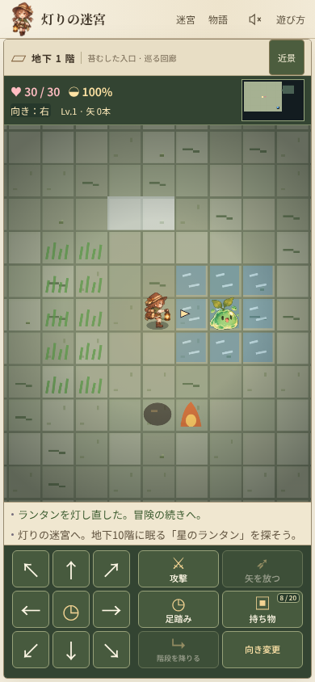
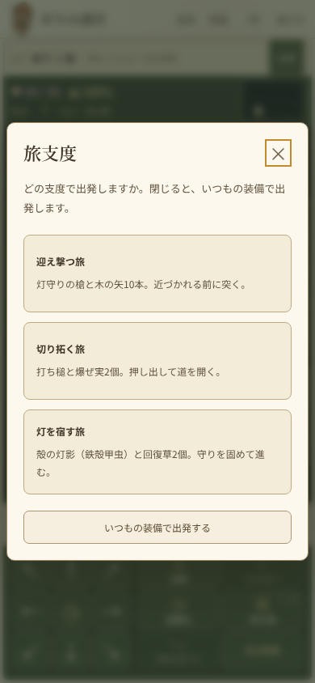

# 灯りの迷宮 — 灯りを集める旅人リネの大冒険

「トルネコの大冒険」のような、一歩ごとに世界が動くブラウザ用ローグライク。キャラクター、名称、ドット絵、効果音は独自のものです。キャラクターは正面・横・背面・斜めを含む8方向のドット絵と方向マーカーで向きを表示します。ライブラリやビルド工程を必要としません。

## キャラクターと世界観

主人公は「灯りを集める旅人、リネ」です。葉飾りの帽子、緑のケープと星の留め具、祖母から譲られたランタンを持ち、かつて灯りを分け合って暮らした人々の遺跡を探索します。苔や花、灯りに惹かれる魔物たちが暮らす、あたたかさと不思議さのある世界です。ヘッダーの「物語」から人物紹介と魔物図鑑を開けます。

参考デザインに基づく描き下ろしの旅人8方向・魔物9系統のスプライトと、遺跡のイラストを `dist/art/` に収録しました。全25種の色違いと紋章、能力・特性は引き継ぎます。近景表示はスマートフォンで従来の2倍、広い画面で1.6倍のマスサイズです。「近景／広域」で切り替えられ、ターンやセーブ状態は変わりません。

スマートフォン縦画面では、体力・満腹度・向きと小さなミニマップを残し、重複表示や凡例を省きました。記録は2行分の領域でスクロールでき、操作ボタンの大きさを維持したまま探索画面を広げています。物語のイラストは「物語」に集約し、デスクトップでもゲームを優先しています。新しい画像もオフラインキャッシュに含みます。

## 起動

このディレクトリで実行し、`http://127.0.0.1:4173` を開きます。Node.jsの標準機能だけを使い、PWAが保存する拡張子なしのプレビューURLにも対応します。

```sh
node scripts/serve.cjs 4173
```

同じWi-Fiのスマートフォンなどから遊ぶ場合は、待ち受けるアドレスを2つ目の引数に指定します。`0.0.0.0` を指定すると、起動時に端末のプライベートIPを含むURLを表示します。

```sh
node scripts/serve.cjs 4173 0.0.0.0
```

LANに公開されるため、信頼できるネットワークでだけ使ってください。通常のHTTPなので、PWAのオフライン保存とホーム画面アプリとしての動作は利用できません。冒険の保存はアクセスしたURLごとに分かれます。

`dist/index.html` を直接開くこともできます。保存の利用可否はブラウザの設定によります。保存できない場合は画面に表示されます。

### 分け灯の回廊（戦略拡充の試作）

起動したURLへ `?trial=strategy` を付けると、地下5階までの試作冒険を遊べます。上記の起動例では `http://127.0.0.1:4173/?trial=strategy` です。

最初に灯守りの槍・薙ぎの斧・鉤の鎌・打ち槌から1つを携えるか、今の装備で進むかを選びます。選ばなかった斧・鎌・槌も、2階・3階・4階に1つずつ識別済みで置かれ、途中で持ち替えられます。どの武器も、敵の方向へ進む操作と「攻撃」ボタンで同じ攻撃をします。敵がいなければ移動し、向きの変更だけでは攻撃しません。

- 灯守りの槍（+2）：直線2マス以内の最初の敵を、その場で攻撃します。
- 薙ぎの斧（+4）：正面と左右斜め前の3マスの敵をまとめて攻撃します。正面に敵がいる時に方向入力で振ります。
- 鉤の鎌（+2）：直線2マス以内の最初の敵を攻撃し、2マス先の敵は1マス手前へ引き寄せます。
- 打ち槌（+3）：当てた敵を2マス押し出します。壁にぶつかると3ダメージ、敵にぶつかると双方に3ダメージです。押した先の罠と蔓も発動します。剛腕の灯影と組み合わせると押し出しが3マスになります。

灯種、蔓の種、香り団子、引き寄せ・入れ替え・仮宿の灯札も持ち物に入っています。灯種や対象を選ぶ札は、持ち物から使い、迷宮をタップするか方向ボタンで照準を動かして確定します。香り団子は食べると満腹度を15回復します。足元の品は持たずに使えます。

置き灯は6手で消え、仮宿の帰還先になります。灯りや餌への誘引は試遊の意見を受けて取り下げました。団子を投げる操作はありません。旧試作の設置済みの餌と誘引状態は、再開時に取り除きます。蔓は自分も踏み、敵の攻撃を止める効果はありません。足踏みを前提とした鐘打ちの槌・返しの盾は試遊の意見を受けて取り下げました。旧試作のセーブは槌を灯守りの槍、返しの盾を旅人の盾に置き換え、補正値・呪い・所持場所を保って再開します。

灯影と4種の武器は通常の冒険と同じ仕組みです（下の「灯影」「操作と目的」を参照）。試作では灯影の欠片が出やすく（35%、2回続けて出なければ3体目は確定）、各階の魔物の一部を別の系統に置き換えて、灯影を選びやすくしています。詳細は[拡充構想](docs/expansion-roadmap.md)を参照してください。

試作は専用のセーブ・魔物記録を使い、通常の10階・30階の冒険や深淵の解放状態とは共有しません。新しい札は識別済みです。商人、非討伐の成長、未識別札の対象操作、植物・水・雷の連鎖は今後の検討範囲です。[設計と検証条件](docs/strategy-expansion.md)も参照してください。

エンジン検証は `node check.cjs` に含まれます（灯影は `tests/check-echoes.cjs`、武器の攻撃の形は `tests/check-weapons.cjs`）。起動中のローカルサーバーで実画面の検証を行う場合は、毎回異なる出力先を指定します。

```sh
node tests/check-strategy-browser.cjs http://127.0.0.1:4173 output/playtest-strategy-ui-1
```

この検証は専用の固定状況から製品のDOM操作を行い、390×844・320×568の表示、取消、使用、保存・再開を確認します。条件別の通過を通常プレイの成績や面白さの証明には使いません。

## iOS 27 / iPadOS 27のホーム画面アプリ（PWA）

HTTPSで公開したURLをブラウザで開き、共有メニューの「ホーム画面に追加」で「Webアプリとして開く」をオンにして追加します。ホーム画面から開くと、ブラウザのタブとは独立したアプリとして起動します。`manifest.webmanifest`に相対URLのアプリID・起動URL・スコープと`standalone`表示を定義し、192px・512px・maskableアイコンと180pxのApple touch iconを同梱しています。ステータスバーは`default`にし、ノッチ・ホームインジケータの余白と動的ビューポートに対応しています。

初回はオンラインで開き、画面下部の「オフラインで遊べます」を確認してください。ゲーム本体と全ローカル資産をまとめて保存した後、機内モードでも起動・探索・自動保存・再開できます。外部のGoogle Fontsは保存せず、オフライン時はシステムフォントを使います。PWAはHTTPSまたは開発用の`localhost`で動作します。`file://`やLANの通常のHTTPではオフライン機能は利用できません。

新しい版はオンライン起動時とアプリに戻った時に確認します。全資産の保存が終わると「更新して再開」が表示され、押した時だけ更新します。開いている同じアプリのタブも再読み込みされます。操作ごと・画面を離れる時に冒険を保存するため、再読み込み後は同じ冒険を再開します。更新が不要な場合も、アプリの全タブを閉じて開き直すと待機中の版が適用されます。ゲームの資産を変更したら`node tests/check-pwa.cjs --refresh`でキャッシュ版を更新し、`node check.cjs`で検証してから公開してください。

冒険は端末の`localStorage`に保存されます。ブラウザからホーム画面アプリへの移行、別の端末・ブラウザ・URLへの移動では保存が共有されない場合があり、同期機能はありません。OSによる保存領域の整理、アプリやブラウザのデータ削除で、冒険とオフライン用データが消える場合があります。

仕様の参照先：[Safari 27.0のWebKitリリース情報](https://webkit.org/blog/18325/webkit-features-for-safari-27-0/)、[iOSのホーム画面Webアプリ](https://webkit.org/blog/17333/webkit-features-in-safari-26-0/#every-site-can-be-a-web-app-on-ios-and-ipados)。iOS 27実機でのホーム画面追加・起動とOSによる復帰は別途確認が必要です。

## Cloudflareへの公開と自動デプロイ

Cloudflare Workers Static Assetsで`dist/`を配信します。Workerコードやゲームのビルドは不要です。`wrangler.jsonc`に公開名・配信ディレクトリ・公開前の検証コマンドを定義しています。

CloudflareダッシュボードでWorkersのGit連携を設定し、GitHubの`y-krn/lantern-dungeon`を選択します。設定は次のとおりです。

- Worker名：`lantern-dungeon`（`wrangler.jsonc`の`name`と一致させます）。
- 本番ブランチ：`main`。
- Root directory：リポジトリ直下（`/`）。`dist`を指定しないでください。
- Build command：`node check.cjs`。
- Deploy command：`npx --yes wrangler@4.149.0 deploy`。
- Preview command：`npx --yes wrangler@4.149.0 preview`（ブランチのPreview buildsを有効にした場合）。

Wrangler 4.149.0にはNode.js 22以降が必要です。Wranglerのバージョンは公開コマンドで固定しています。Workers BuildsはWranglerの`build.command`を使わないため、ダッシュボードにも`node check.cjs`を設定してください。検証に失敗したビルドは公開されません。接続後は`main`へのpushで本番を更新し、Preview buildsを有効にすると他のブランチも確認用URLへ公開できます。

ローカルで公開設定を検証する場合は次を実行します。ゲーム検証も自動実行され、Cloudflareへのアップロードは行いません。

```sh
npx --yes wrangler@4.149.0 deploy --dry-run
```

本番URLはWorkersのデプロイ結果に表示されます。ドメインを変更すると既存の`localStorage`セーブやダンジョン解放状態は新サイトへ引き継がれません。端末間同期もありません。継続利用する本番URLを固定してください。Cloudflareへの切替でSitesの設定や既存の保存データは削除されません。

公式資料：[Static Assets](https://developers.cloudflare.com/workers/static-assets/)、[Workers Buildsの設定](https://developers.cloudflare.com/workers/ci-cd/builds/configuration/)。

## 操作と目的

- 矢印キー / WASD：移動。敵へ移動すると攻撃。
- Q / E / Z / C：左上 / 右上 / 左下 / 右下への移動。
- Shift＋移動キー：その場で向きだけ変更。8方向に対応し、ターン・満腹度は変わらず、敵も動きません。
- T / 「向き変更」ボタン：向き変更モードの切替。方向ボタン・移動キー・迷宮タップが向き変更になります。もう一度押すと移動に戻ります。
- Space / F：向いている方向へ攻撃。
- R：装備した木の矢を向いている方向へ発射。1本消費し、最初の敵に12ダメージ。
- . / X：足踏み。
- I：持ち物。アイテムの使用・装備・装備解除で1ターン進みます。木の矢は「装備」で剣・盾と併用でき、「外す」で解除できます。木の矢は1回につき1〜10本をランダムに拾います。矢は「木の矢 × 本数」とまとめて表示し、本数にかかわらず持ち物の1枠を使います。
- Enter：階段の上で次の階へ。
- M：ミニマップ切替。H / ?：遊び方。
- スマートフォン：迷宮直下の方向ボタン。迷宮をタップしても、その方向へ1歩移動できます。

最初はチュートリアル「灯りの迷宮」（10階）を探索します。地下10階の星の番人を倒し、星のランタンへ到達するとチュートリアル完了です。クリア後に「深淵の迷宮」（30階）が解放され、クリア画面または「ダンジョン選択」から挑戦できます。地下30階の深淵の番人を倒し、深淵のランタンへ到達するとクリアです。

深淵の迷宮は敵が各階2体増加し、通常敵の出現表を2階先へ進めます。同じ名前の敵に追加の能力補正はかかりません。罠は各階最大8個、パンは各階2個です（チュートリアルは最大5個、パン3個）。武器と盾は各階でそれぞれ40%の確率で出現します。種類の抽選率は全階・両迷宮で共通です。浅い階でも強い装備が出現し、深い階でも弱い装備が出現します。拾った装備を持ち物から選んで装備できます。冒険ごとにレベル・持ち物・所持金は初期化されます。体力が0になると冒険が終了します。

武器・盾は拾うと持ち物に入り、「装備」で持ち替えます。持ち替えは1ターンを使い、以前の装備を同じ持ち物枠に戻します。持ち物は装備を含めて最大20枠です。装備中の武器・盾も各1枠を使い、予備装備は1個につき1枠です。パン・回復草・灯札・地形の道具など同じ種類の道具は、3個まで1枠にまとまります（持ち物では「× 個数」と表示）。矢は装備の有無によらず1束で1枠です。装備を持ち替えても使用枠数は変わりません。満杯でも、3個に満たないまとまりへは同じ道具を拾えます。それ以外は床に残ります。不要な予備装備は「置く」で足元に戻して枠を空けられます（1ターン）。足元に別のアイテムがある場合は置けません。鑑定済みの装備は性能と現在の装備との差を持ち物欄に表示します。未鑑定の補正値や呪いは表示しません。

装備が出現した場合の種類別抽選率と性能は以下のとおりです。攻撃力は「5 +（レベル − 1）× 2 + 武器の基本性能 + 補正値」（最低1）、防御力は「1 + 盾の基本性能 + 補正値」（最低0）です。未装備の場合は基本性能と補正値を0とします。

- 武器：木の剣（+0、10%）、銅の剣（+3、19%）、鉄の剣（+6、20%）、星鉄の剣（+9、7%）、祓いの剣（+3、9%、亡霊への近接ダメージ2倍）、破甲のつるはし（+4、8%、近接攻撃で装甲による軽減を無視）、灯守りの槍（+2、6%）、薙ぎの斧（+4、6%）、鉤の鎌（+2、6%）、打ち槌（+3、6%）、禍つの大鎌（+10、3%、後述）。特殊効果は矢や雷光の灯札には付きません。
- 武器の形：槍・斧・鎌・槌は、敵の方向へ進む操作と「攻撃」で同じ攻撃をします。敵がいなければ移動します。槍は直線2マス以内の最初の敵をその場で突き、鎌は同じ射程で攻撃して2マス先の敵を1マス引き寄せます。斧は正面と左右斜め前の3マスをまとめて攻撃します。槌は当てた敵を2マス押し出し、壁にぶつかると3ダメージ、敵にぶつかると双方に3ダメージを与えます。引き寄せ・押し出した先のトゲ罠は魔物にも発動します。
- 盾：旅人の盾（+0、12%）、銅の盾（+2、27%）、鉄の盾（+4、25%）、星鉄の盾（+6、8%）、革の盾（+1、15%、自然な満腹度減少が8ターンに1）、鏡の盾（+2、10%、敵の遠距離攻撃を防御力で軽減した後に半減、端数切り上げ）、禍つの鏡盾（+5、3%、後述）。革の盾は敵の空腹攻撃を防がず、鏡の盾は近接攻撃・強打・罠には効きません。

初代トルネコの大冒険の「種類ごとの基本性能と特殊効果を使い分ける」考え方を参考に、名前・数値・確率はこのゲーム用に設定しています。持ち物上限20枠は初代に合わせています。参考：[取扱説明（最大20個）](https://gcgx.games/torneko/info.html)、[アイテム図鑑](https://gcgx.games/torneko/item.html)、[不思議のダンジョンの出現抽選](https://gcgx.games/torneko/dungeon1.html)。補正値と呪いの鑑定・解呪は、既存の鑑定機能を引き継ぎます。旧セーブの装備は攻撃力・防御力を保って移行し、持ち替え後も補正を保持します。

迷宮は4〜8部屋を接続して毎階生成します。視界、敵の追跡、経験値とレベル、剣と盾、罠、回復草、パン、矢、雷光の灯札、道しるべの灯札を実装しています。満腹度は通常4ターン（革の盾装備中は8ターン）で1減少し、0になると毎ターン体力が減ります。満腹時は7ターンごとに体力が1回復します。

ブラウザの `localStorage` に行動ごとに保存します。端末・ブラウザ・URLごとに独立した保存です。チュートリアルのクリアによる解放は冒険セーブと別に保存され、死亡・再挑戦後も維持されます。従来のセーブはチュートリアルとして復帰し、保存済みクリアは解放を引き継ぎます。ブラウザの保存データを消すと解放状態も消えます。サーバー保存や端末間同期はありません。Google Fonts の取得に失敗した場合はシステムフォントを使用します。

## 灯影

倒した魔物は15%の確率で「灯影の欠片」を残します。4回続けて出なければ、5体目は必ず残します。番人は残しません。欠片を踏むとリネのランタンに宿り、その魔物の系統の力を得ます。宿せる灯影は一つで、新しい欠片を踏むと入れ替わります。持ち物の枠は使わず、満杯でも宿せます。灯影の種類と効果は最初から分かります。

| 灯影 | 残す魔物 | 効果（上位種は強化） |
|---|---|---|
| 苔 | 苔・琥珀スライム | 5歩進むごとに体力+1（+2） |
| 翼 | 洞窟・紅翼・黒曜コウモリ | 見える敵がいない時（上位：3マス以内にいない時）、1回の移動で2マス進む |
| 灯弾 | 氷翼・雷翼コウモリ、灯り・氷灯の亡霊 | 正面に届く敵がいない時、「攻撃」が直線3（4）マス以内の最初の敵に届く。威力は攻撃力の半分 |
| 喰らい | 灯喰い蛾、月蝕蛾、翡翠コウモリ、翡翠の亡霊 | 近接攻撃が当たるたび満腹度+1（+2） |
| 金灯 | 黄金の亡霊 | 敵を倒すたび体力+3 |
| 揺らぎ | 深淵の亡霊 | 敵の攻撃を受けた後、1/4の確率で同じ部屋の3マス以内へ転移 |
| 殻 | 鉄殻・蒼鋼甲虫 | 防御力+2（+4） |
| 根 | 棘吐き草、月光花 | 2ターン続けて攻撃を当てると、2回目以降の攻撃+3（+5） |
| 擬態 | 金貨・星貨ミミック | 眠っている敵が気づく距離を7マスから3（2）マスに縮める |
| 剛腕 | 石拳・黒曜ゴーレム | 近接攻撃が当たった敵を1マス押し出す。壁や敵にぶつかると追加2（4）ダメージ。打ち槌と組み合わせると押し出しは3マス |

宿した灯影はサイドバーの装備欄（スマートフォンでは上部の進行欄）、持ち物、魔物図鑑で確認できます。翼の灯影の2歩目は、品を拾った・罠を踏んだ・階段に着いた・敵が見えた時に止まります。灯影は保存され、階移動や再読込でも維持されます。灯影の導入前のセーブは、灯影なしとして再開します。

## 地形

各階の部屋には、水たまり・草むら（3階以降は油だまりも）が自然に現れます。各階に地形を作る道具が1つ置かれます。地形は魔物にもリネにも同じ規則で働きます。

- **水たまり**：雷光の灯札で敵を打つと、その敵とつながった水たまり全体に雷が伝わり、上にいる者すべてに18ダメージを与えます。見えていない敵や、同じ水たまりにいるリネも対象です。火を消します。
- **油だまり**：火が付くと3ターン燃え、隣の油と草むらに燃え広がります。
- **草むら**：中にいる間、敵は遠くからリネを狙えません（隣接攻撃は受けます）。火が付くと2ターン燃えます。
- **霧**：中にいる間、敵は遠くからリネを狙えません。霧のマスを狙った射撃・強打は空振りします。5ターンで晴れます。
- **炎**：ターンの終わりに、炎のマスにいる者へ4ダメージ。魔物は炎のマスへ歩いて入りません。何もない床に付いた火は、そのターンで消えます。

道具は持ち物から使います。水袋・油瓶・火種・爆ぜ実は向いている方向へ投げ、最初の敵のマス、壁の手前、または4マス先に落ちます。

| 道具 | 効果 |
|---|---|
| 水袋 | 落ちた周囲3×3を水たまりにする。火も消す |
| 油瓶 | 落ちた周囲3×3を油だまりにする |
| 火種 | 落ちたマスに火を放つ。そこにいる敵に10ダメージ |
| 爆ぜ実 | 落ちた周囲3×3に15ダメージ。リネも巻き込まれる。油と草むらに火が付く |
| 煙玉 | 足元の周囲5×5に霧を広げる |

地形は保存され、再読込しても続きから遊べます。地形の導入前のセーブは、地形なしとして再開します。



## 矢に灯す

木の矢を持っている時、持ち物の雷光の灯札・火種・煙玉に「矢に灯す」が表示されます。使うと（1ターン）その品を消費し、次に放つ5本の矢がその力を帯びます。新しく灯すと前の灯りと入れ替わります。サイドバーの矢の欄（スマートフォンでは進行欄）に残り本数を表示します。

| 灯 | 元の品 | 矢が当たった時 |
|---|---|---|
| 雷の灯 | 雷光の灯札 | 命中した敵とつながった水たまりにいる者すべてに12ダメージ（リネも含む）。水たまりがなければ命中した敵に追加6ダメージ |
| 火の灯 | 火種 | 命中したマス（外れた時は止まったマス）に火を放つ |
| 霧の灯 | 煙玉 | 命中したマスの周囲3×3に霧を広げる |

未識別の灯札には表示されず、灯すことで正体が分かることはありません。目の前の壁へ放った矢は飛ばないため、灯りを消費しません。灯りの状態は保存されます。

## 旅支度・灯台・露店

**旅支度**：新しい冒険を始めると、三つの支度から一つを選べます。閉じると、いつもの装備で出発します。再開した冒険では表示しません。

| 支度 | 内容 |
|---|---|
| 迎え撃つ旅 | 灯守りの槍（識別済み・補正0）と木の矢10本 |
| 切り拓く旅 | 打ち槌（識別済み・補正0）と爆ぜ実2個 |
| 灯を宿す旅 | 殻の灯影（鉄殻甲虫）と回復草2個 |

**灯台**：灯りの迷宮の3・6・9階、深淵の迷宮の5の倍数の階（30階を除く）に一つあります。上に立って「灯台に触れる」を押すと、三つの灯りから一つを受け取れます。受け取るのにターンは使いません。候補は階ごとに決まり、再読込しても変わりません。

| 灯り | 効果 |
|---|---|
| 灯りの息吹 | 最大体力+8、体力+8 |
| 刃の灯／盾の灯 | 装備中の武器／盾の補正値+1 |
| 灯影の授け | 決まった魔物の灯影を宿す |
| 安らぎの灯 | 体力と満腹度をすべて回復 |
| 矢の灯 | 木の矢15本 |
| 真名の灯（深淵のみ） | 未識別の灯札をすべて識別し、持ち物の未鑑定品をすべて鑑定 |

**露店**：両迷宮の4の倍数の階（最深部を除く）に一つあります。上に立って「露店を見る」を押すと、金貨で次のことができます。ターンは使いません。

- 品物：パン・回復草・木の矢10本・地形の道具1種・灯札1種。売り切れ制で、値段は階が深いほど上がります。
- 鑑定：持ち物と装備の未鑑定品・未識別の灯札をまとめて鑑定します。1品ごとの料金です。
- 解呪：装備中の呪いをすべて解きます。



## 灯影の二枠・共鳴・武器の進化・禍つ装備

**灯影の二枠**：灯台の「灯芯の灯」を受け取ると、ランタンに灯影を二つ宿せます。空き枠があれば新しい灯影はそこに入り、二つとも埋まっていれば古いほうと入れ替わります。同じ系統を二つ宿しても効果は重ならず、強いほうだけが働きます。

**共鳴**：二つの灯影が次の組み合わせの時、追加の効果が働きます。持ち物とサイドバーの灯影欄に表示されます。

| 共鳴 | 組み合わせ | 効果 |
|---|---|---|
| 流星 | 翼＋灯弾 | 灯弾の威力が半分にならない |
| 奇襲 | 擬態＋喰らい | まだ気づいていない敵への攻撃が2倍 |
| 苔むす殻 | 苔＋殻 | 苔の灯影が3歩ごとに働く |
| 地鳴り | 剛腕＋根 | 押し出しの衝突ダメージ+3 |

**武器の進化**：槍・斧・鎌・槌は、その武器で倒した数を数えます（武器ごとに保存）。12体倒し、対応する灯影を宿した状態で灯台に触れると、4つ目の候補として進化を選べます。条件を満たしていない時も、候補に条件と残り数を表示します。進化しても補正値と呪いは引き継ぎます。

| 進化前 | 必要な灯影 | 進化後 |
|---|---|---|
| 灯守りの槍 | 灯弾 | 流星の槍（+5、射程3、最初の敵の奥の1体も貫く） |
| 薙ぎの斧 | 喰らい | 喰らいの大斧（+7、当たった敵1体ごとに体力+1） |
| 鉤の鎌 | 擬態 | 影縫いの鎌（+4、射程3、最大2マス引き寄せ） |
| 打ち槌 | 剛腕 | 崩しの大槌（+6、3マス押し出し、衝突6ダメージ） |

**禍つ装備**：必ず呪われた状態で見つかる、強い代わりに代償のある装備です。清めの灯札か露店の解呪で清めると、呪いと代償・特殊効果が消え、基本性能が半分になります。

- 禍つの大鎌（武器+10）：呪いがある間、満腹度が2ターンに1減る。
- 禍つの鏡盾（盾+5）：呪いがある間、遠距離攻撃を跳ね返して攻撃した敵に当てる。回復草の効果は半分。

## 鑑定と呪い

灯札は、灯りの力を封じた小さな札です。「かざす」で力を解き放ちます。雷光・道しるべ・真名・清めの4種類があり、従来の効果を引き継ぎます。

鑑定は初代SFC版『トルネコの大冒険』の識別仕様を基準にし、道具の名称と見た目はランタンの世界観に合わせています。チュートリアルでは灯札を識別済み、高難度の「深淵の迷宮」では未識別にします。草や木の矢は従来どおり識別済みです。指輪と杖はこのゲームにはありません。

- **剣・盾**：種類名は拾った時点で分かりますが、補正値と呪いは未鑑定です。自動では装備されず、持ち物の1枠を使います。装備するとその1つだけ鑑定されます。同じ種類でも別の個体は未鑑定のままです。装備中の武器・盾も20枠の持ち物上限に含まれます。
- **装備の交換**：持ち物の「装備」で現在の装備と交換します。「外す」で持ち物へ戻し、「置く」で未装備の剣・盾を床に置けます。装備解除は同じ持ち物を移すだけなので、満杯でも使用枠数は変わりません。使用、装備、解除、床に置く操作は1ターン進みます。
- **呪い**：拾った剣・盾は1/8の確率で呪われています。装備すると外すことも別の装備への交換もできなくなります。呪い自体は能力を変えません。補正値による能力変化とは別の状態です。
- **灯札**：深淵の迷宮では「赤い灯札」などの仮名で表示され、効果も隠れます。仮名と正体の対応は冒険ごとに変わります。同じ種類の灯札は同じ仮名で、かざすか鑑定するとその冒険中の同種すべてが識別されます。効果が発生しない状況でかざしても識別されます。
- **命名**：未識別の灯札の「名前」で、推測した効果を20文字以内で記録できます。同種すべてに表示されますが、正式な識別にはなりません。命名ではターンを消費しません。
- **真名の灯札**：持ち物または装備中の品1つを選んで鑑定します。剣・盾は補正値と呪いを、灯札は正体を明らかにします。鑑定しても呪いは解けません。対象選択をキャンセルした場合は、識別、灯札消費、ターン進行のいずれも起きません。
- **清めの灯札**：装備中の剣・盾の呪いをすべて解きます。未装備の品には効かず、補正値も変わりません。

各階に鑑定・解呪を含む灯札を追加で1枚配置します。装備の基本性能は種類で決まり、拾った品の初期補正値は全階共通で−1〜+3です。階数による基本性能・補正値の加算はありません。補正値1につき攻撃力または防御力が1変わります。既存の戦闘バランスを使うため、原作の全アイテムや出現率を再現する変更ではありません。

仮名、命名、識別、装備ごとの補正値と呪いは保存され、階移動や再読込でも維持されます。新しい冒険では灯札の識別と命名を初期化します。鑑定導入前のセーブは灯札・装備を識別済みとして移行し、装備の攻撃力・防御力を引き継ぎます。灯札への名称変更前のセーブも再開でき、仮名の色と識別済みの種類、命名、呪いを維持したまま表示名を移行します。

仕様確認資料：[アイテム図鑑（SFC）](https://gcgx.games/torneko/item.html)、[アイテムの効果と呪い](https://peamon.net/toruneko1/toruneko1-item-data.html)。

## 魔物のバリエーション

魔物は全25種です。同じ名前ならHP・攻撃力・経験値と特性は固定で、階数やダンジョンによる能力補正はありません。色違いの別種に加え、甲虫・植物・ミミック・蛾・ゴーレムは別の形のドット絵で見分けられます。「遊び方」から「魔物図鑑を見る」を開くと、全種の見た目・能力・特徴・対処法を確認できます。

遠距離攻撃と強打は、敵が構えたターンに黄色のマスと「!」で予告されます。次のターンに予告した1マスだけを攻撃するため、移動して回避できます。敵は構えてから着弾するまで移動しません。遠距離攻撃は縦・横・斜めの直線だけで、壁や別の敵が射線を遮ります。向きだけの変更や図鑑を開く操作では敵の攻撃は進みません。

- **苔スライム**（苔色、HP 9、攻撃力 3、経験値 3）：2ターンに1歩進みます。隣接中は毎ターン攻撃します。 対処：距離を取って矢で攻撃。追いかけられても離れやすい相手です。
- **琥珀スライム**（琥珀色、HP 15、攻撃力 6、経験値 5）：毎ターンHPを1回復します。 対処：攻撃を続け、回復する隙を与えずに倒しましょう。
- **洞窟コウモリ**（紫、HP 17、攻撃力 7、経験値 7）：1ターンに最大2歩接近します。移動したターンは攻撃しません。 対処：早めに矢で迎撃。距離2でも次の行動で隣接します。
- **紅翼コウモリ**（赤、HP 25、攻撃力 10、経験値 9）：1ターンに最大2歩接近します。移動したターンは攻撃しません。 対処：早めに矢で迎撃。距離2でも次の行動で隣接します。
- **氷翼コウモリ**（水色、HP 35、攻撃力 14、経験値 11）：直線3マス以内の1マスを狙い、次のターンに遠距離攻撃します。 対処：狙われたマスから移動。壁や別の敵でも射線を遮れます。
- **雷翼コウモリ**（黄、HP 45、攻撃力 18、経験値 14）：直線4マス以内の1マスを狙い、次のターンに遠距離攻撃します。 対処：狙われたマスから移動。壁や別の敵でも射線を遮れます。
- **翡翠コウモリ**（翡翠色、HP 55、攻撃力 22、経験値 16）：近接攻撃が当たると、体力に加えて満腹度を3減らします。 対処：矢で先に倒すか、パンを温存して接近戦を短くしましょう。
- **黒曜コウモリ**（銀灰色、HP 69、攻撃力 27、経験値 20）：1ターンに最大2歩接近します。移動したターンは攻撃しません。 対処：早めに矢で迎撃。距離2でも次の行動で隣接します。
- **灯りの亡霊**（薄桃色、HP 27、攻撃力 11、経験値 11）：直線3マス以内の1マスを狙い、次のターンに遠距離攻撃します。 対処：狙われたマスから移動。壁や別の敵でも射線を遮れます。
- **氷灯の亡霊**（水色、HP 37、攻撃力 15、経験値 13）：直線4マス以内の1マスを狙い、次のターンに遠距離攻撃します。 対処：狙われたマスから移動。壁や別の敵でも射線を遮れます。
- **黄金の亡霊**（金色、HP 47、攻撃力 19、経験値 16）：毎ターンHPを3回復します。 対処：矢と剣を組み合わせ、短いターンで倒しましょう。
- **翡翠の亡霊**（翡翠色、HP 57、攻撃力 23、経験値 18）：近接攻撃が当たると、体力に加えて満腹度を4減らします。 対処：矢で先に倒すか、パンを温存して接近戦を短くしましょう。
- **深淵の亡霊**（銀紫色、HP 71、攻撃力 28、経験値 22）：攻撃を受けると、次の行動で同じ部屋の3マス以内へ転移します。転移中は攻撃しません。 対処：転移先を確認して矢で追撃。通路では転移できません。
- **星の番人**（金色、HP 65、攻撃力 14、経験値 30）：隣の1マスを狙い、次のターンに強打します。 対処：予告のマスから移動し、空振りの隙に攻撃しましょう。
- **深淵の番人**（青紫色、HP 180、攻撃力 34、経験値 100）：直線5マス以内の1マスを狙い、次のターンに遠距離攻撃します。 対処：狙われたマスから移動。壁や別の敵でも射線を遮れます。
- **鉄殻甲虫**（鉄灰色、HP 18、攻撃力 5、経験値 7）：剣と矢のダメージを2軽減します。受けるダメージは最低1です。 対処：雷光の灯札は殻の軽減を無視できます。
- **蒼鋼甲虫**（鋼青色、HP 49、攻撃力 16、経験値 16）：剣と矢のダメージを4軽減します。受けるダメージは最低1です。 対処：雷光の灯札は殻の軽減を無視できます。
- **棘吐き草**（若草色、HP 20、攻撃力 8、経験値 10）：移動せず、直線4マス以内の1マスを狙って次のターンに攻撃します。 対処：射線を外して近づくか、予告に合わせて横へ移動しましょう。
- **月光花**（月白色、HP 48、攻撃力 20、経験値 19）：移動せず、直線5マス以内の1マスを狙って次のターンに攻撃します。 対処：射線を外して近づくか、予告に合わせて横へ移動しましょう。
- **金貨ミミック**（金色、HP 20、攻撃力 8、経験値 10）：金貨の山に化けています。隣接すると正体を現し、そのターンは攻撃しません。攻撃されると即座に正体を現します。 対処：正体を見たら距離を取り、矢で迎撃。反撃前の1ターンを使いましょう。
- **星貨ミミック**（白金色、HP 64、攻撃力 24、経験値 25）：金貨の山に化けています。隣接すると正体を現し、そのターンは攻撃しません。攻撃されると即座に正体を現します。 対処：正体を見たら距離を取り、矢で迎撃。反撃前の1ターンを使いましょう。
- **灯喰い蛾**（橙色、HP 12、攻撃力 4、経験値 6）：近接攻撃が当たると、体力に加えて満腹度を3減らします。 対処：矢で先に倒すか、パンを温存して接近戦を短くしましょう。
- **月蝕蛾**（藍紫色、HP 38、攻撃力 15、経験値 17）：近接攻撃が当たると、体力に加えて満腹度を5減らします。 対処：矢で先に倒すか、パンを温存して接近戦を短くしましょう。
- **石拳ゴーレム**（石灰色、HP 34、攻撃力 14、経験値 14）：隣の1マスを狙い、次のターンに強打します。移動は2ターンに1歩です。 対処：予告のマスから移動し、空振りの隙に攻撃しましょう。
- **黒曜ゴーレム**（黒紫色、HP 86、攻撃力 32、経験値 30）：隣の1マスを狙い、次のターンに強打します。移動は2ターンに1歩です。剣と矢のダメージを4軽減します。 対処：予告のマスから移動し、空振りの隙に攻撃しましょう。

出現する種類は深さに応じて変わり、同じ種類が複数の階に出ても能力は変わりません。初めの1〜2階は苔スライムのみ、3〜5階相当から甲虫・ミミック・蛾、6階相当から植物・ゴーレムが加わります。深淵の迷宮では実際の階数に2を加えて出現表を参照します。ボスはチュートリアル10階の星の番人と、深淵30階の深淵の番人です。敵の総数は増やしていません。

従来の15種のセーブも再開できます。古い階数補正のセーブは対応する別種へ移行し、受けたダメージを引き継ぎます。倒した敵は復活せず、瀕死の敵はHP 1を下限として引き継ぎます。敵の攻撃予告、ミミックの発覚、転移待ちも保存され、再読込で予告を消せません。

## 検証

ブラウザでの固定シード自動プレイと改善点の評価手順は[ブラウザ自動プレイ](docs/browser-playtest.md)を参照してください。`node scripts/browser-playtest.cjs --seeds 101,102,103 --out output/playtest-baseline`で、行動履歴・スクリーンショット・保存復帰検証を含むレポートを生成します。

```sh
node check.cjs
```

`check.cjs` はゲームのJavaScriptファイルの構文と、`tests/` に集約した全検証をまとめて実行します。各検証は `node tests/check-engine.cjs` のように単独でも実行でき、起動時の作業ディレクトリに依存しません。`tests/check-modules.cjs` はHTMLの読込順、ブラウザとCommonJSでの状態・乱数の一致、描画時の状態不変、冒険切替、画面サイズ別のタップ座標、描画ループの重複防止を検証します。

`tests/check-inventory-ui.cjs` は持ち物UIの公開APIを直接読み込み、ブラウザとCommonJSの両方で足元操作・鑑定・交換・キャンセル・命名・警告表示・冒険切替後の参照を検証します。持ち物UIの検証では `game.js` のソース文字列を切り出す必要はありません。

`tests/check-sprites.cjs` はスプライトモジュールをブラウザとCommonJSの両方で読み込み、画像の読込完了・失敗、主人公の8方向、種別ごとの色替え・キャッシュ、アイテム画像の優先、ドット絵への代替描画を検証します。描画の呼出元は従来どおり `renderer.sprite()`・`renderer.ready`・`renderer.itemsReady` を利用できます。

`tests/check-pwa.cjs` はmanifest・アイコン・全ローカル資産のキャッシュ対象・内容ハッシュによる版更新を検証します。Service Workerを実行し、通信失敗時の旧版保持、オフライン応答、明示更新、スコープ内だけのキャッシュ削除、認証リダイレクト・外部資産・非GETリクエストの除外も確認します。

`tests/check-identification.cjs` は個体別の装備鑑定、呪いによる交換禁止、解呪、灯札の同種識別、命名とリセット、対象選択の取消、保存・旧セーブ移行、壊れた鑑定状態の拒否を検証します。`tests/check-equipment.cjs` は武器・盾12種の全階共通抽選、4,000回の床アイテム生成、装備込み20枠、満杯時の持ち替え・解除・矢の追加、特殊効果、保存復帰と旧装備の性能維持を検証します。

`tests/check-engine.cjs` は全25種の出現、4,000階での同名敵の能力固定、ダメージを受けた旧セーブの移行と再保存も検証します。`tests/check-traits.cjs` では物理軽減と灯札、速度、射線、予告回避、ミミックの猶予、空腹攻撃、再生、転移、特性の保存復帰を検証します。100シード×チュートリアル10階と100シード×深淵30階の接続、階段到達、アイテム・敵・罠の配置、満腹度、アイテム消費、矢の装備・解除・スタック・残数・持ち物の容量、レベルアップ、旧セーブを含むセーブ復帰、死亡、番人によるクリア条件、30階の終端、チュートリアル完了後の解放、冒険切替・再読込・保存失敗時の解放維持を検証します。

## ファイル

- `dist/index.html`：画面と操作パネル。
- `dist/style.css`：共通表示、画面幅・縦画面の条件、持ち物・足元操作、配色・仕上げを区分したスタイル。条件と適用順を維持し、変更は対応するセレクタとメディアクエリにまとめます。`svh`・`dvh`などの連続した宣言はブラウザ向けのフォールバックとして残します。
- `dist/data.js`：アイテム・装備・魔物・ダンジョンの定義と共通の判定関数。
- `dist/world.js`：部屋・通路・階段・敵・アイテム・罠の生成。
- `dist/enemies.js`：敵の行動、追跡、射撃予告、再生、転移。
- `dist/save.js`：セーブの検証と旧形式からの移行。
- `dist/engine.js`：シード付き乱数、持ち物・戦闘・ターン制ルール。各処理の呼出元。
- `dist/sprites.js`：スプライト画像の読込・切出し・色替え・キャッシュ、画像未読込時のドット絵描画、主人公の方向別選択。ゲーム状態に依存しない描画モジュール。
- `dist/renderer.js`：地形・アイテム・キャラクターの配置、ミニマップ、カメラ・戦闘演出・タップ座標。スプライト描画は `sprites.js` を呼び出します。
- `dist/inventory-ui.js`：足元と持ち物の表示・操作、鑑定・交換・命名、足元の案内。現在のエンジンを受け取る独立したUIモジュール。
- `dist/game.js`：画面更新、入力・冒険切替、共通ダイアログ、効果音、自動保存。
- `dist/manifest.webmanifest`・`dist/icons/`：ホーム画面アプリの起動設定とアイコン。
- `dist/pwa.js`・`dist/sw.js`：オフライン準備、更新案内、全資産の版ごとの保存。
- `check.cjs`：依存ライブラリ不要の一括検証。
- `tests/check-*.cjs`：機能別の検証。PWAのキャッシュ版更新は `node tests/check-pwa.cjs --refresh` で実行します。
- `.openai/hosting.json`：Sitesの配置先と静的配信設定。
- `wrangler.jsonc`：Cloudflare Workersの静的配信と公開前の検証設定。

ゲーム中の読み取り専用スナップショットは `window.lanternGame.snapshot()` から取得できます。

`dist/` のJavaScriptはビルド生成物ではなく、直接編集するソースです。機能追加は担当ファイルに置き、ゲーム状態の変更はエンジンの操作経由で行います。描画は状態を読み取るだけで、敵AIや生成処理はDOMに依存しません。`index.html` の `defer` 読込順を維持してください。Node.jsでは従来どおり `require('./dist/engine.js')` で依存ファイルも読み込めます。
