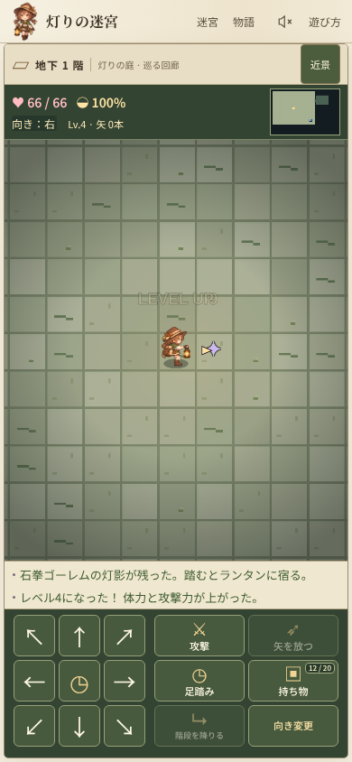
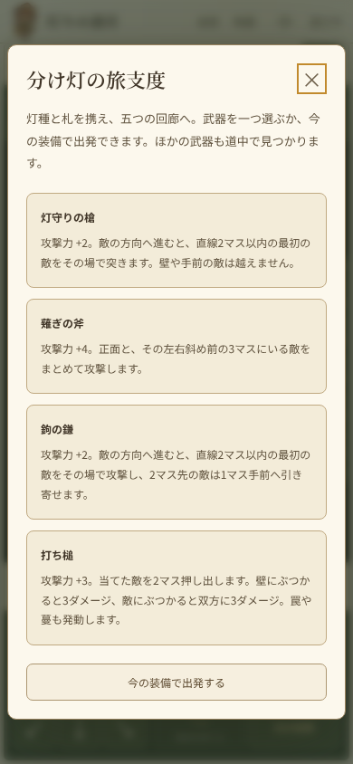

# 拡充構想 — 魔物の灯影を宿し、戦場を組み替える

## 文書の位置づけ

2026-10-17時点の構想提案です。[戦略拡充案](strategy-expansion.md)の試作（槍・蔓・置き灯・引き寄せ・入れ替え・仮宿）と試遊の意見を前提に、装備・灯札・アイテムをどこまで広げ、そのためにゲーム性のどこを変えるべきかをまとめます。数値はすべて初期案で、実装・検証はまだ行っていません。

- 調査基準：`origin/main` `656ee0e`。
- 試遊で取り下げた方向は再提案しません。**足踏みや待機を前提とする効果**（鐘打ちの槌・返しの盾）と、**灯りや餌で魔物を誘う効果**です。
- 現行の前提：1行動1ターン、8方向、攻撃予告、持ち物20枠、武器6・盾6・灯札4、魔物25種（9系統）、金貨の使い道なし。

## 結論：ゲーム性で変えるべき5点

トルネコ・シレン型の「拾った物で切り抜ける」面白さは維持したまま、次の5点を変えることを提案します。上ほど効果が大きく、優先度も高いと考えます。

| # | 変更 | 何が変わるか | 主な参考 |
|---|------|--------------|----------|
| 1 | **ランタンを第3の装備にし、倒した魔物の「灯影」を宿す** | 25種の魔物が、そのまま25通りの能力の入手先になる。敵を見る目が「脅威」から「欲しい能力」に変わる | 星のカービィのコピー能力、Hadesの功徳、Balatroのジョーカー |
| 2 | **床に「性質」の層を加える（水・油・草・霧）** | 雷・火・蔓・押し出しが地形と連鎖し、同じ札の価値が盤面で変わる | Divinity: Original Sin、ゼルダ ブレス オブ ザ ワイルド／ティアーズ オブ ザ キングダム、Noita |
| 3 | **武器を「性能差」から「攻撃の形」へ** | 槍・斧・鎌・槌・双剣で、同じ方向入力の結果が変わる。押し出し・薙ぎ払い・引き寄せが標準操作になる | Into the Breach、Hadesの武器と相、Dead Cells |
| 4 | **選べる報酬と金貨の使い道** | 数階ごとの「灯台」で3択、商人で購入・鑑定・解呪。ランダム頼みの冒険に方針が生まれる | Slay the Spire、Hades、Spelunky、The Binding of Isaac |
| 5 | **冒険の外側：誓約・日替わり迷宮・図鑑の解放** | 同じ30階を、縛りと目標を変えて何度も遊べる | Hadesの罰の契約、Balatroのステーク、Spelunkyのデイリー |

1だけで「誰も遊んだことのない」核になり得ます。2〜3は1と組み合わさる土台、4〜5は長く遊ばれるための外枠です。

---

## 1. 灯影（ほかげ）— 魔物の力をランタンに宿す

### 体験

リネのランタンは、倒した魔物の残り火「灯影」を吸い込み、その魔物の性質を写し取ります。コウモリの灯影なら2歩で駆け、甲虫なら殻で身を守り、棘吐き草なら離れた敵を撃てる。どの魔物を、どの灯影を残すために倒すかを選ぶゲームになります。

既存の魔物図鑑と9系統の特性（2歩接近、遠距離予告、満腹度吸収、装甲、転移、擬態、強打）が、すでに能力の素材としてそろっている点が本作の強みです。新しい魔物を増やすほど、能力も同時に増えます。

### 仕組み

- ランタンを武器・盾に並ぶ第3の装備にします。最初は**灯影の枠1つ**、深い階の灯台や特定の装備で**最大2つ**まで増えます。
- 灯影は、魔物を倒したときに一定確率で床に残る「灯影の欠片」を拾って宿します。初期案は通常魔物10%、同じ系統を2体連続で倒すと次は確定。番人は確定で落とします。
- 「写しの灯札」で、見えている魔物1体から倒さずに写し取ることもできます（後述）。
- 枠が埋まっているときに新しい灯影を宿すと、古い灯影は消えます。持ち物には入れず、20枠を圧迫しません。
- 灯影は種類名・効果とも最初から判明しています。識別の楽しみは灯札と装備に任せ、ここでは選択の楽しみに集中します。
- 同じ系統の上位種（氷翼→雷翼など）の灯影は、効果の数値だけが強くなります。

### 灯影の初期一覧（系統ごと）

すべて通常の移動・攻撃・道具使用の中で発動し、足踏みを条件にしません。

| 魔物の系統 | 灯影の名前 | 効果（下位種／上位種） |
|---|---|---|
| スライム（苔・琥珀） | 苔の灯影 | 5歩移動するごとにHP+1／+2。戦わずに歩くほど回復する |
| 速いコウモリ（洞窟・紅翼・黒曜） | 翼の灯影 | 移動の後、敵と隣接していなければ同じ方向にもう1歩（満腹度を1追加消費） |
| 射撃コウモリ・亡霊（氷翼・雷翼・灯り・氷灯） | 灯弾の灯影 | 「攻撃」が直線3／4マス以内の最初の敵に届く。近接より威力は半分 |
| 吸収（翡翠コウモリ・翡翠の亡霊・蛾） | 喰らいの灯影 | 攻撃が当たるたび満腹度+1／+2。食料の消費が攻撃回数で埋まる |
| 黄金の亡霊 | 金灯の灯影 | 敵を倒すとHP+3。連戦ほど持ちこたえる |
| 深淵の亡霊 | 揺らぎの灯影 | 被弾時に25%で、同じ部屋の3マス以内の空きマスへ転移する（その攻撃は受ける） |
| 甲虫（鉄殻・蒼鋼） | 殻の灯影 | 受けるダメージ−2／−4（最低1） |
| 植物（棘吐き草・月光花） | 根の灯影 | 直前の行動が攻撃だった場合、次の攻撃+3／+5。連続攻撃に報いる（待機ではない） |
| ミミック（金貨・星貨） | 擬態の灯影 | 部屋に入ったとき、眠っている敵は最初にリネが攻撃するまで起きない |
| ゴーレム（石拳・黒曜） | 剛腕の灯影 | 近接攻撃が当たった敵を1マス押し出す。壁・敵に当たると追加2ダメージ |
| 番人 | 星の灯影／深淵の灯影 | 枠を使わない常時効果。最大HP+10、または攻撃予告が1ターン早く見える |

### 組み合わせが生む戦略

2枠になると、能力同士が掛け算になります。作者が用意する「共鳴」と、システムから自然に出る連鎖の両方を用意します。

- **自然な連鎖**：剛腕で押し出す → 押し出した先が水たまり → 雷光の灯札で水ごと感電。翼で2歩動き → 灯弾で射程の端から撃つ。殻と苔で、攻撃を受け止めながら歩いて回復する。
- **共鳴（少数の作者設定）**：特定の組み合わせだけ追加効果。例：翼＋灯弾で「2歩動いたターンの射撃は威力が下がらない」、擬態＋喰らいで「起きていない敵への初撃は2倍」。共鳴は図鑑に記録され、見つけること自体が冒険の目標になります（Hadesの複合功徳、Balatroのジョーカー同士の噛み合いに相当）。

### 設計上の注意

- 灯影は「敵をおびき寄せる」効果を持たせません。試遊で取り下げた誘引と同じ不満を招くためです。
- 擬態の灯影は非討伐の攻略を初めて成立させる能力です。経験値以外の成長（後述の灯台）とセットで導入します。
- 能力の強さは「持たない場合より強い」ではなく「別の解き方を可能にする」かで調整します。殻の灯影だけが常に最良、という状態を避けます。

---

## 2. 床の性質 — 地形が札と装備を変える

### 仕組み

マスごとに、壁・床・罠とは別の「性質」を一つだけ持たせます。種類は4つから始めます。

| 性質 | 生成 | 作用 |
|---|---|---|
| 水たまり | 部屋に自然生成、水袋で作る | 雷が隣接する水たまり全体へ伝わり、上にいる者すべてに当たる。火を消す |
| 油だまり | 油瓶で作る、一部の部屋に生成 | 火が触れると3ターン燃え、上の者へ毎ターン4ダメージ。燃え広がるのは隣接する油だけ |
| 草むら | 植物系の部屋に生成、蔓の種で作る | 中にいる者は遠距離攻撃の対象にならない（隣接は可）。火で燃える |
| 霧 | 霧の灯札で作る | 霧の中のマスへの射撃予告は空振り。視界も1マスに制限。5ターンで晴れる |

- 魔物にもリネにも同じ規則で作用させます。敵が自分の雷で水場の仲間を巻き込むことも起こります。
- 性質は常に盤面に描画し、ルールは図鑑の「地形」ページで確認できます。隠れた性質は作りません。
- 燃焼・霧の持続は既存の置き灯と同じく「敵行動フェーズ」で数え、保存します。
- 1マスに重ねられる性質は一つ。水に油を撒くと油が浮いて燃えやすくなる、などの複合は採用しません。読みやすさを優先します。

### なぜ必要か

現在の札と矢は「見えている敵へのダメージ」で完結しており、場所を選ぶ理由が少ないためです。性質の層があると、雷光の灯札は「敵が水場に入るまで温存する」札になり、ゴーレムの灯影や槌は「敵を油へ押す」武器になります。Divinity: Original Sinやブレス オブ ザ ワイルドの、知っている物理法則を組み合わせる楽しさを、1ターン制で読みやすい形にします。

---

## 3. 装備 — 攻撃の形と、育つ武器

### 武器：形の違いを主役にする

現在の6種は、主に数値と特効で違います。これを残しつつ、**方向入力したときに何が起きるか**で分かれる武器を加えます。方向入力で敵へ攻撃する槍の操作（試作済み）と同じ規則で統一し、追加のボタンは作りません。

| 武器 | 基本 | 攻撃の形 | 得意 | 苦手 |
|---|---|---|---|---|
| 灯守りの槍（試作済み） | +2 | 直線2マス以内の最初の敵を突く | 接近前の迎撃 | 隣接後の囲まれ |
| 薙ぎの斧 | +4 | 正面と左右斜め前の3マスを同時に攻撃 | 通路の出口、群れ | 単体相手は剣と同じ |
| 鉤の鎌 | +2 | 2マス先の敵を攻撃し、1マス引き寄せる | 射撃敵を手元へ、罠へ誘導 | 隣接中は通常攻撃のみ |
| 打ち槌 | +3 | 当てた敵を2マス押し出す。壁・敵・罠への衝突で追加効果 | 罠・水・油と連携、囲みからの脱出 | 押した敵がまた近づく |
| 灯の双剣 | +0 | 1回の攻撃で2回判定（各回は攻撃力の60%） | 低防御の敵、命中時効果の灯影 | 装甲の甲虫 |
| 投げ輪の円盤 | +1 | 直線4マス先まで飛び、最初の敵に当たって戻る。戻る途中の敵にも当たる | 一直線の通路 | 壁で跳ね返らない斜め |

### 盾：受けた瞬間に起きること

待機を前提にしない受け身の効果だけを加えます。

- **棘蔓の盾**（+2）：隣接から攻撃されると、相手に2ダメージ。
- **灯籠の盾**（+1）：被弾するたび足元に1ターンだけ灯りが点き、霧と草むらを晴らす。
- **濡れ革の盾**（+2）：火・燃焼を受けない。雷は2倍受ける。水場では防御+2。
- **重鉄の盾**（+7）：強い代わりに、翼の灯影と円盤の戻り判定が働かない。重さで動きが変わる盾です。

### 育つ武器と「灯打ち（進化）」

Vampire Survivorsの武器進化と、ゼルダ ティアーズ オブ ザ キングダムの「スクラビルド」を合わせた仕組みです。

- 武器は、その武器で倒した数を記録します。一定数（初期案15体）に達すると「灯が馴染む」状態になります。
- 馴染んだ武器と特定の灯影をそろえた状態で灯台に触れると、その場で別の武器へ進化します。例：
  - 灯守りの槍＋灯弾の灯影 → **流星の槍**（射程3、最初の敵を貫通して2体目にも当たる）
  - 打ち槌＋剛腕の灯影 → **崩しの大槌**（押し出す距離3、衝突時の追加ダメージ2倍）
  - 薙ぎの斧＋殻の灯影 → **城壁の斧**（攻撃した敵の数だけ次の被ダメージ−1）
  - 祓いの剣＋金灯の灯影 → **送り火の剣**（亡霊への特効を全魔物の半分に拡大）
- 進化の組み合わせは図鑑に「未発見」として枠だけ表示し、試した人が見つけられるようにします。

### 呪いに「利点」を与える

現在の呪いは「外せない」だけです。Slay the SpireやThe Binding of Isaacの、強いが代償のある品に倣い、深い階に**禍つ装備**を加えます。呪われているが強く、外せないことが代償と利点の両方になります。

- 禍つの大鎌（+10、満腹度の自然減少が2倍）
- 禍つの鏡盾（+5、受ける遠距離攻撃を反射するが、回復草の効果が半分）

清めの灯札で呪いを解くと利点も弱まり（基本性能が半分）、解くかどうかが判断になります。

---

## 4. 灯札 — 場所を作る札、写す札、重ねる札

試作の引き寄せ・入れ替え・仮宿を「動かす札」とし、次の3群を加えます。

### 場所を作る札（床の性質と連携）

- **水脈の灯札**：直線3マス以内の3×3を水たまりにする。
- **火灯の灯札**：直線4マス以内の1マスに火を放つ。油・草むらは燃える。単体には10ダメージ。
- **霧の灯札**：自分の周囲5×5に霧。射撃予告を無効にして逃げる、または近づく。
- **突風の灯札**：向いている方向の扇状3マスにいる敵をすべて2マス押し出す。

### 写す・増やす札

- **写しの灯札**：見えている魔物1体の灯影を、倒さずに宿す。番人には効かない。
- **合わせ鏡の灯札**：持ち物の消耗品1つを複製する。灯札自身と灯影は対象外。

### 札を「重ねる」：矢への灯付け

持ち物から灯札を選び「矢に灯す」で、矢の束の一部（5本）をその札の性質を帯びた矢に変えます。ゼルダ ティアーズ オブ ザ キングダムの「矢と素材の合成」に相当し、矢が単なる12ダメージから戦術の運び手になります。

| 灯した札 | できる矢 | 効果 |
|---|---|---|
| 雷光 | 雷の矢 | 命中した敵と、その敵と同じ水たまりにいる者へ12ダメージ |
| 火灯 | 火の矢 | 着弾マスに火。油・草むらを燃やす |
| 引き寄せ | 鉤の矢 | 命中した敵を2マス手前へ |
| 蔓の種 | 縫いの矢 | 命中した敵の次の自発移動を止める |
| 霧 | 煙の矢 | 着弾点の周囲3×3に霧 |

札1枚で5本になるため、「札として一度に使う」か「矢として分けて使う」かを選べます。矢の束は同じ種類ごとに1枠とし、持ち物の圧迫を抑えます。

### 未識別の扱い

深淵では新しい札も仮名にします。正体によって照準の種類が変わると正体が漏れる問題（戦略拡充案で指摘済み）には、**すべての未識別札を「方向を1つ選ぶ」共通照準**で使う方式を提案します。方向を必要としない札は、選んだ方向を無視して発動します。投げ・設置系は選んだ方向の直線上で最も遠い有効マスへ働きます。

---

## 5. アイテム — 消耗品の拡充

食料・回復の救済枠と、戦術用の枠を別に抽選します（戦略拡充案の方針を継承）。

### 戦術用

- **爆ぜ実**：投げると着弾点の周囲3×3に15ダメージ。壁は壊さない。油に当たると燃える。
- **水袋**：投げた地点の3×3を水たまりにする。火を消す。
- **油瓶**：投げた地点の3×3を油だまりにする。
- **煙玉**：足元の5×5に霧。

### 補給・成長

- **蛍蜜**：満腹度+30。食べてから20ターン、視界が1マス広がる。
- **露の小瓶**：体力+15、満腹度+10。回復草とパンの中間。
- **灯芯の種**：ランタンの灯影の枠を1つ増やす（最大2）。深層の灯台・宝箱限定。
- **力の灯油**：武器の補正値+1。**守りの灯油**：盾の補正値+1。補正値を育てる手段がない現状を補います。

### 持ち物の整理

品数を増やすと20枠が判断の主役になり過ぎるため、**同じ種類の消耗品は3個まで1枠**にまとめる変更を提案します。装備と灯札は従来どおり1個1枠です。矢は種類ごとに1束1枠とします。

---

## 6. 冒険の流れ — 選択と経済

### 灯台（3つから1つ選ぶ報酬）

3階ごと（深淵では5階ごと）に、階段の近くに灯台を置きます。触れると3つの候補から1つ選べます。候補は「灯影の枠や効果の強化」「武器の進化」「装備の補正値」「最大HP」「新しい灯札を識別」から抽選します。

Slay the Spireの報酬選択とHadesの功徳選択のように、ランダムな拾い物の上に「自分で方針を決める瞬間」を重ねます。経験値に頼らない成長の受け皿にもなり、擬態の灯影による非討伐の攻略を成立させます。

### 商人と金貨

- 4階ごとに商人の部屋を置き、金貨で購入・鑑定・解呪・装備の補正値+1を受けられます。
- 店の品を持ったまま部屋を出ると泥棒扱いになり、番兵が現れます（Spelunky、トルネコの泥棒の要素）。高リスクの選択肢として残します。
- 価格は通常プレイの金貨取得量を測ってから決めます（戦略拡充案の方針を継承）。

### 旅支度（開始時の選択）

冒険の開始時に、3つの「旅支度」から1つ選びます。例：灯守りの槍と灯種2つ／殻の灯影と回復草2つ／打ち槌と突風の灯札。Slay the Spireの開始時ボーナスに相当し、最初の数階の方針を決めます。

---

## 7. 冒険の外側 — 何度も遊ぶ理由

- **誓約**：クリア後、縛りを選んで再挑戦できます（Hadesの罰の契約、Balatroのステーク）。例：灯台が3択から2択、敵の攻撃予告が1マス短い、満腹度の減少が速い、灯影の枠が1つ。誓約の合計値が記録されます。
- **日替わりの迷宮**：日付から決まるシードで、全員が同じ迷宮に一度だけ挑戦できます（Spelunkyのデイリー）。既存の固定シード生成がそのまま使えます。結果は端末内の記録として始め、共有は後で検討します。
- **図鑑の解放**：魔物図鑑に「灯影」「共鳴」「武器の進化」「地形」の頁を加え、発見したものを記録します。一定の発見で、次の冒険から新しい品が抽選に加わります（The Binding of Isaacの解放）。最初からすべての品を出さないことで、初見の人が覚える量も抑えられます。

---

## 取り下げた方向・採用しない方向

- 待機・足踏みで溜める効果、溜め攻撃。テンポを損なうため。
- 灯り・餌・音で魔物を誘う効果（誘引）。試遊で楽しくないと判断済みのため。デコイ（身代わり）も同じ理由で採用しません。
- 時間で減るランタンの燃料管理。灯影の魅力を「失う不安」で上書きしないため。
- 属性相性の表（火は草に強い等の倍率表）。盤面で見える性質の作用だけで連鎖させます。
- 全品・全組み合わせを最初から出すこと。解放で段階的に増やします。

## 導入の順序

一度に全部を入れず、原因が分かる単位で試作と試遊を繰り返します。各段階は試作冒険（`?trial=strategy` と同じく専用の保存先）で検証してから、本編へ移します。

1. **灯影（1枠）**：ランタン装備、欠片のドロップ、系統ごとの11種、図鑑の灯影頁。既存の魔物と戦闘処理だけで成立し、効果の確認がしやすい段階です。ここで「敵を見る目が変わるか」を初見試遊で確かめます。
2. **攻撃の形**：斧・鎌・槌の3種と、試作の押し出し・引き寄せ処理の共通化。剛腕の灯影と同じ押し出し処理を使います。
3. **床の性質**：水・油・草・霧と、水脈・火灯・霧・突風の札、爆ぜ実・水袋・油瓶。
4. **矢への灯付けと消耗品のまとめ**：矢の種類別の束、3個まとめ。
5. **灯台・商人・旅支度**：成長と経済。価格はここで初めて決めます。
6. **灯影2枠・共鳴・武器の進化・禍つ装備**：組み合わせの深さ。
7. **誓約・日替わり・解放**：冒険の外側。

## 検証の考え方

[戦略拡充案](strategy-expansion.md)の受け入れ条件（取消で状態が変わらない、保存・再読込で結果が一致する、未発見の情報を漏らさない）をすべての段階に適用します。加えて次を確認します。

- 灯影：どの灯影を選んだか、選ばなかった理由、灯影ごとの到達階と被害。特定の1種が全盤面で最良になっていないこと。
- 床の性質：連鎖の結果を、行動前に盤面から予測できたか。予想と結果のずれを試遊で聞き取ります。
- 武器の形：同じ固定状況で、武器ごとに異なる手順で突破できること。
- 報酬選択：灯台で迷った時間と、選んだ方針がその後の拾い物の扱いを変えたか。
- モバイル：390×844・320×568で、性質・予告・置き灯・灯影の表示が重ならないこと。色だけに頼らず形でも区別します。

勝率や平均ダメージだけでは採否を決めません。「同じ盤面に複数の解き方があり、拾った物で解き方が変わり、結果の理由が盤面から分かる」ことを採用の条件にします。

## 実装への影響

- `dist/data.js`：ランタン装備、灯影、新しい武器・盾・札・消耗品、床の性質の定義。
- `dist/engine.js`：攻撃の形（範囲・押し出し・引き寄せ・多段）、灯影の発動点、床の性質の作用と連鎖、灯台・商人。
- `dist/enemies.js`：床の性質を考慮した経路（燃えている油を避けるなど）、霧の中への予告の空振り。
- `dist/world.js`：性質の自然生成、灯台・商人の部屋、解放状態による抽選表。
- `dist/save.js`：ランタン・灯影・床の性質・武器の撃破数・誓約・解放の保存と、旧セーブの移行（灯影なし・性質なしとして移行）。
- `dist/renderer.js`・`dist/sprites.js`：性質のタイル、灯影の表示、新しい武器の攻撃演出。
- `dist/inventory-ui.js`・`dist/game.js`：ランタン欄、灯台の3択、商人、矢への灯付け、まとめ表示。

## 試作の実装状況（2026-10-17）

導入順序の1「灯影（1枠）」を、`?trial=strategy` の試作冒険に実装しました。本編の10階・30階には入れていません。

- 灯影は番人を除く23種すべてに対応し、系統ごとに10種類です。系統表の「星の灯影／深淵の灯影」は、試作が5階で終わるため見送りました。
- 欠片の出現率は試作向けに35%とし、2回続けて出なければ3体目で必ず出ます。罠や敵同士の攻撃で倒れた場合も出ます。上の構想の10%は、30階の本編を想定した値です。
- 欠片は倒れたマス（ふさがっていれば隣接マス）に置かれ、踏むと宿ります。持ち物には入りません。
- 試作の各階では、通常の魔物の一部を別の系統に置き換えます。1階は蛾・甲虫、2階はコウモリ・棘吐き草、3階はミミック・ゴーレム、4階は紅翼コウモリ・亡霊、5階は琥珀スライム・月蝕蛾です。
- 擬態の灯影のために、敵が気づく距離を返す `wakeRange()` を `enemies.js` から参照します。本編のエンジンはこの関数を持たず、従来どおり7マスです。
- 翼の灯影は、移動先に品・罠・階段がある場合や、1歩目で敵が見えた場合に1マスで止まります。正体を現していないミミックは「見える敵」に数えず、正体を漏らしません。
- 保存は試作のversion 2のままです。灯影・歩数・欠片の救済回数・直前の攻撃ターンを検証してから読み込みます。旧試作のセーブは灯影なしとして再開します。

`tests/check-echoes.cjs` は、全系統の対応、欠片の救済、入れ替え、10種の効果、保存の拒否、試作で出会える系統の数を検証します。390×844と320×568のChromiumで、討伐→欠片→宿す→状態欄・持ち物の表示を確認し、横スクロールとブラウザ例外がないことを確かめました。`tests/check-strategy-browser.cjs` は agent-browser がこの環境になく、実行していません。人間による試遊も未実施です。

### 第2段階：攻撃の形（2026-10-17）

導入順序の2として、薙ぎの斧・鉤の鎌・打ち槌を試作冒険に加えました。槍と同じく、方向入力と「攻撃」ボタンで同じ攻撃になります。

- 薙ぎの斧（+4）：正面と左右斜め前の3マス。閉じた角の先には届きません。正面に敵がいない時は方向入力で移動します。
- 鉤の鎌（+2）：槍と同じ射程2で、2マス先の敵を1マス引き寄せます。引き寄せた先の罠・蔓は発動します。
- 打ち槌（+3）：2マス押し出します。壁なら3ダメージ、敵に当たれば双方に3ダメージで止まります。剛腕の灯影の押し出しを共通の処理にまとめ、槌と組み合わせると押し出しは3マス、衝突ダメージに剛腕の追加分が加わります。
- 旅支度で4種から選べます。斧・鎌・槌は2〜4階に1つずつ、識別済み・補正0・呪いなしで置きます。本編の抽選表には入れていません（出現の重みは0）。
- 構想の「灯の双剣」「投げ輪の円盤」は、まず3種で判断が変わるかを見てから追加します。

`tests/check-weapons.cjs` は、斧の8方向・背後・角、鎌の射程・壁・蔓、槌の押し出し・衝突・罠・剛腕との組み合わせ、旅支度、2〜4階の配置、保存の一致を検証します。390×844と320×568のChromiumで、旅支度の5択と斧の一振りで3体を倒す操作を確認しました。`tests/check-strategy-browser.cjs` の旅支度の数は5に更新しました。agent-browser 0.27.0（Playwright同梱のChromiumを指定）で実行し、試作UIの検証と、通常冒険の条件別ブラウザ検証8ケースが通過しました。

### 本編への導入（2026-10-17）

灯影と4種の武器（槍・斧・鎌・槌）を、通常の10階・30階の冒険へ導入しました。仕組みは `engine.js` に移し、試作は同じ処理の上で欠片の出やすさ・魔物の置き換え・旅支度だけを変えます。

- 欠片の出現率は15%、4回続けて出なければ5体目で確定です。構想の10%より高めにし、通常プレイでの灯影の交換頻度を見て調整します。
- 武器の抽選率は既存6種の比率をおおむね保ったまま縮め、新しい4種に各6%を割り当てました（合計100）。
- 押し出し・引き寄せでトゲ罠に入った魔物には罠が発動します。魔物が自分で歩いて罠を踏む処理は、通常の冒険では従来どおり発動しません。
- 新しい武器と欠片はまだ描き下ろしのドット絵がなく、文字の記号で描画しています。
- 3シード×600ターンの通常の自動プレイで、欠片の出現・宿す・入れ替えが起き、1シードが10階を踏破しました。ブラウザ例外はありませんでした。

### 第3段階：床の性質（2026-10-17、本編に直接導入）

水たまり・油だまり・草むら・霧・炎と、それを作る道具5種（水袋・油瓶・火種・爆ぜ実・煙玉）を、試作を経ずに通常の冒険へ導入しました。仕様はREADMEの「地形」を参照してください。

- 構想から変えた点：
  - 地形を作る札（水脈・火灯・霧・突風）は見送り、識別の必要がない道具として実装しました。灯札を増やすと深淵の未識別名と照準の問題が生じるためです。
  - 投げる道具は照準UIを使わず、向いている方向へ投げます。試作の照準UIを本編に持ち込まずに済みます。
  - 霧は視界を狭めず、遠くからの狙いと予告済みの攻撃だけを外します。
- 雷光の灯札は、見えている敵とつながった水たまり全体へ伝わります。見えていない敵とリネも巻き込みます。
- 魔物は炎のマスへ歩いて入りません。押し出し・引き寄せで炎に入れることはできます。
- `tests/check-terrain.cjs` で、地形の生成、投げた道具の着地点、延焼と鎮火、伝導、爆発、草むらと霧、保存の検証を確認しています。

### 第4段階：矢への灯付けと消耗品のまとめ（2026-10-17、本編に直接導入）

- 同じ種類の道具は3個まで1枠にまとまります。満杯でも、3個に満たないまとまりへは拾えます。装備は従来どおり1個1枠、矢は1束1枠です。（その後、試遊の意見を受けて取り下げました。下の「持ち物の見直し」を参照）
- 「矢に灯す」は、矢を別の品に変えず、次の5本に効果を乗せる方式にしました。矢の種類を増やすと、持ち物・装備・保存の扱いが矢の種類ごとに分かれるためです。灯す元は、本編にある雷光の灯札・火種・煙玉です。構想の引き寄せ・蔓は試作専用の品のため、まだ対象にしていません。
- 未識別の灯札は灯せません。灯すことで正体が漏れないようにするためです。
- 既存の検証のうち、持ち物を満杯にするためにパンを18個などで埋めていたものは、まとめの導入で満杯にならなくなりました。予備の盾で枠を埋める形に置き換えています。

### 第5段階：灯台・露店・旅支度（2026-10-17、本編に直接導入）

仕様はREADMEの「旅支度・灯台・露店」を参照してください。

- 構想の「灯影の枠や効果の強化」「武器の進化」は、灯影2枠・進化の段階で灯台の候補に加えます。今回は既存の要素に効く7種です。
- 灯台は3階ごと（深淵は5階ごと）、露店は4階ごとです。通常プレイでの金貨と被害を測ってから、値段と間隔を調整します。
- 露店での持ち逃げ（泥棒と番兵）はまだ実装していません。
- 灯台と露店はボタンで開き、自動では開きません。自動プレイのボットや、移動中のプレイヤーの操作を止めないためです。
- 旅支度は、新しい冒険（初回・再挑戦・迷宮の選択）でのみ表示し、再開したセーブでは表示しません。

### 第6段階：灯影の二枠・共鳴・武器の進化・禍つ装備（2026-10-17、本編に直接導入）

仕様はREADMEの同名の節を参照してください。

- 二枠目は灯台の候補「灯芯の灯」から得ます。構想の「灯芯の種」（アイテム）は、灯台で足りるかを見てから検討します。
- 共鳴は4組です。図鑑への記録はまだありません。
- 進化は4系統です。構想の「送り火の剣」（祓いの剣）は見送りました。進化に必要な撃破数は12体です。
- 禍つ装備は武器・盾に各1種、出現率3%です。既存の銅の剣・銅の盾の出現率から3%ずつ割り当てました。
- 進化した武器と禍つ装備も、まだドット絵がなく記号で描画しています。

### 持ち物の見直し（2026-10-17）

試遊の意見を受け、消耗品を3個まで1枠にまとめる仕組みを取り下げました。代わりに持ち物の上限を20枠から24枠に増やしました。どの道具を何個持っていくかを、1個ずつプレイヤーが選ぶためです。矢は従来どおり1束で1枠です。

構想の導入順序（1〜6）はここまでです。残りは誓約・日替わり迷宮・図鑑の解放です。

## 参考にした作品

- 星のカービィ（コピー能力）— 敵の能力を写し取り、遊び方が変わる。灯影の発想の元です。
- Hades — 武器の相、功徳の選択と複合功徳、罰の契約。
- Balatro — 少数の常時効果が掛け算で噛み合う設計、ステーク。
- Slay the Spire — 報酬の選択、開始時の選択、代償のある呪い。
- Into the Breach — 予告を読み、押し出しで盤面を組み替える戦闘。
- Divinity: Original Sin、ゼルダ ブレス オブ ザ ワイルド／ティアーズ オブ ザ キングダム、Noita — 地形の性質と連鎖、素材の合成。
- Vampire Survivors — 条件をそろえた武器の進化。
- Spelunky — 商人と泥棒、デイリー。The Binding of Isaac — 解放による品の追加。

これらは仕組みの参考です。本作での面白さや適切な数値を証明するものではなく、本書の具体案は本作向けの設計判断です。

### 罠のバリエーション（2026-10-17、本編に直接導入）

トゲの罠に加えて、落とし穴・転移・錆・警鐘・火・油の罠を加えました（仕様はREADMEの「罠」）。罠の処理を `springTrap()` に一本化し、リネが踏んだ時と、押し出し・引き寄せで魔物が入った時に同じ規則で発動します。火と油の罠は地形と連鎖し、落とし穴は槌・鎌で魔物を落とす使い方ができます。
