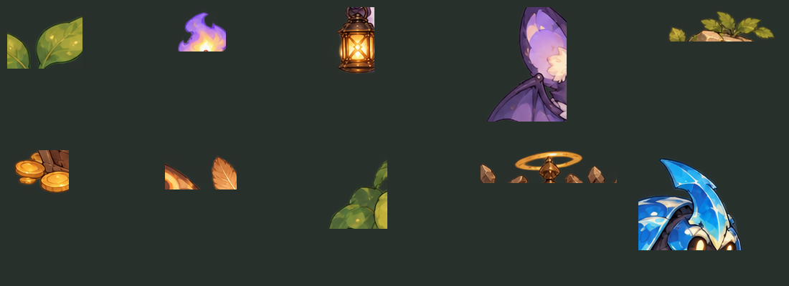

# 魔物の図柄バリエーション案（実装仕様）

## 文書の位置づけ

2026-10-17時点の設計提案です。実装はCodexが担当する前提で、仕組み・種ごとの指定・検証条件まで具体的に書いています。見た目の数値はすべて初期案で、画面で見ながら調整します。

- 基準：`origin/main` `a0d7633`（魔物12種と灯冠の精鋭の追加後）
- 対象：魔物の描画（迷宮・魔物図鑑）。ゲームの規則は変えません。

## 現状

- 魔物は37種（番人2種を含む）です。絵は `dist/art/lantern-atlas.png` の9系統のシルエット（slime・bat・ghost・beetle・plant・mimic・moth・golem・guardian）だけです。
- 同じ系統の種は、`sprites.js` の `paintedSprite()` で `colors[1]` に合わせて色相を回すだけで描き分けています。違いは色と、右上の段階の印だけです。
- そのため、コウモリ8種・亡霊7種などは同じ形の色違いに見え、行動が違うこと（盗む・鐘を鳴らす・下がって撃つ、など）が絵から伝わりません。

## 方針

新しい絵を描かずに、**今の手描きの絵柄を保ったまま形を変える**ことを目標にします。手段は次の5つです。

1. **部品の流用**：アトラスの手描きの部品（若葉・炎・ランタン・金貨・苔・光輪・触角・殻、持ち物アトラスの矢・盾・巻物など）を切り出し、別の種に付けます。同じ画家の筆致なので、描き足しても絵柄が浮きません。
2. **体型の変化**：大きさと縦横比を種ごとに変えます。深い段階ほど大きくします。
3. **模様の重ね塗り**：絵の不透明な部分だけに模様（斑点・縞・ひび・霜・錆・泥・光る紋様）を重ねます（canvasの `source-atop` 合成）。輪郭は保ちます。
4. **目の色と光**：系統ごとの目の位置に、種ごとの色の光を重ねます。
5. **周囲の演出**：後光・粒子（泡・火の粉・霜・火花・花びら・錆の欠片・泥の滴）・半透明のゆらぎを、種ごとに付けます。

形の違いは、なるべく行動の違いに対応させます。盗むコウモリは金貨を抱え、影弓の亡霊は矢を持ち、大盾ゴーレムは盾を構えます。絵を見ただけで、何をしてくる敵かの見当が付くようにします。

## 仕組み

### 見た目の定義（`dist/data.js`）

各魔物に `look` を加えます。省略した項目は既定値（変化なし）です。

```js
look: {
  size: 1.0,            // 全体の倍率。0.8〜1.25。タイルからはみ出さない範囲で
  shape: [1, 1],        // 横・縦の倍率（体型）
  alpha: 1,             // 不透明度（亡霊の変種などで0.8前後）
  pattern: { type: "spots", color: "#c8f0ff", alpha: 0.35 },   // 模様
  parts: [              // 流用する部品（描く順）
    { part: "ghostFlame", x: 0.5, y: 0.05, scale: 0.35, rotate: 0, flip: false, layer: "front", hue: 0 },
  ],
  eyes: "#ffd66b",      // 目の光の色
  aura: { color: "#9fd6a8", radius: 0.6 },                     // 後光
  particles: { type: "bubbles", color: "#e2f6fb", count: 3 },  // 周囲の粒子
}
```

- 部品の位置 `x`・`y` は、シルエットの枠を0〜1とした相対座標です。`scale` も枠の幅に対する比率です。
- `layer: "back"` の部品は本体より先に、`"front"` の部品は本体の後に描きます。
- `hue` は部品だけの色相回転（度）です。

### 部品の切り出し（`dist/sprites.js`）

`PART_FRAMES` に、部品の切り出し範囲 `[sx, sy, w, h]` と元画像（`atlas` か `itemAtlas`）を定義します。

下の値は、提案時に試し切りした**おおよその範囲**です。実装時に正確な範囲を測ってください（透明部分を含めず、部品が欠けない範囲）。

| 部品 | 元画像 | おおよその範囲 | 内容 |
|---|---|---|---|
| `slimeSprout` | atlas | 95,614,105,86 | 苔スライムの若葉 |
| `ghostFlame` | atlas | 665,608,85,62 | 亡霊の頭の紫の炎 |
| `ghostLantern` | atlas | 588,760,72,100 | 亡霊の手提げランタン |
| `mimicCoins` | atlas | 294,1060,86,70 | 宝箱の脇の金貨 |
| `golemMoss` | atlas | 860,878,240,57 | ゴーレムの頭の苔と若葉 |
| `mothAntenna` | atlas | 620,890,100,55 | 蛾の触角 |
| `plantLeaf` | atlas | 20,880,90,110 | 植物の葉 |
| `guardianHalo` | atlas | 60,1134,190,46 | 番人の光輪 |
| `beetleHorn` | atlas | 950,620,168,140 | 甲虫の角と殻の前部 |
| `stoneChips` | atlas | 18,1180,90,80 | 番人の周りの石片（範囲は要測定） |
| `arrow` | itemAtlas | 既存の `itemFrames.arrow` | 木の矢 |
| `shield` | itemAtlas | 既存の `itemFrames.ironShield` | 鉄の盾 |
| `scroll` | itemAtlas | 既存の `itemFrames.scroll` | 灯札 |
| `bell` | なし | 手続き的に描く小さな金の鐘 | 鐘鳴りコウモリ用（唯一の手描き追加） |

提案時の試し切りの結果です（上段左から若葉・炎・ランタン・翼・苔、下段左から金貨・触角・葉・光輪・殻）。おおよその範囲でも、部品として使える質があることを確認しました。



実装の手順：

- 範囲の確認用に、`scripts/monster-parts-sheet.cjs` を作ってください。全部品を切り出して1枚の画像に並べます。
- 出力を `output/` に保存し、欠け・余白を目で確認してから値を確定します。

### 合成と描画

- **合成（キャッシュ）**：`sprites.js` で、種ごとに一度だけオフスクリーンcanvasに合成します。
  1. 後ろの部品
  2. 本体（既存の色相回転）
  3. 模様（`source-atop`）
  4. 前の部品
  5. 目の光

  キャッシュの鍵は `species` のままにします（`paintedSprites`）。合成に乱数を使わないでください。
- **毎フレームの描画**：`renderer.js` で、毎フレーム次を描きます。
  1. 後光（本体の前）
  2. 本体（`size` と `shape` を既存の拡大縮小に掛け合わせる）
  3. 粒子（本体の後）

  粒子は `now` と `e.id` から決まる位置にして、乱数を使いません。
- **動きを減らす設定**（`reduced`）：粒子と揺らぎを止めます。後光は静止表示にします。
- **大きさの上限**：拡大後の高さがタイルの1.25倍を超えないようにします。灯冠の冠と「!」の位置も、大きさに合わせてずらします。
- **擬態中のミミック**：これまでどおり金貨の山として描き、`look` を一切反映しません（正体を漏らさないため）。
- **魔物図鑑**：同じ合成画像を使います。粒子・後光は図鑑では静止表示にします。

## 種ごとの見た目

「部品」の列は、流用する部品と付ける位置です。大きさは S＝0.85、M＝1.0、L＝1.12、XL＝1.22 です。

### スライム（slime）

| 種 | 大きさ・体型 | 模様 | 部品 | 目 | 演出 |
|---|---|---|---|---|---|
| 苔スライム | M | なし | （元の若葉） | — | — |
| 琥珀スライム | M・やや横長 | 金の斑点 | — | 金 | 蜜の滴（下へ） |
| 泡スライム | S | 細かい泡 | 後ろに半分の大きさの自分の影（分裂の暗示） | 水色 | 泡が上る |
| 錆スライム | M | 錆の斑 | — | 橙 | 錆の欠片が落ちる |
| 泥スライム | L・横長（1.15×0.9） | 下半分に泥の筋 | — | 黄土 | 泥の滴、影を茶色に |

### コウモリ（bat）

| 種 | 大きさ・体型 | 模様 | 部品 | 目 | 演出 |
|---|---|---|---|---|---|
| 洞窟コウモリ | M | なし | — | — | — |
| 紅翼コウモリ | M | 翼に炎の縞 | 頭に小さな `ghostFlame`（赤に色相） | 赤 | 火の粉 |
| 氷翼コウモリ | M | 霜 | — | 水色 | 冷気の霞 |
| 雷翼コウモリ | M | 稲妻の縞 | — | 黄 | 火花 |
| 翡翠コウモリ | M | 翡翠の斑点 | 胸に `plantLeaf`（小） | 翠 | — |
| 黒曜コウモリ | L | 光るひび | — | 紫 | 暗い後光 |
| 灯盗みコウモリ | S | 目の周りに暗い帯（覆面） | 足元に `mimicCoins`（抱える） | 白 | — |
| 鐘鳴りコウモリ | M | なし | 胸の下に手続きの `bell` | 金 | 起きている時、音の輪 |

### 亡霊（ghost）

| 種 | 大きさ・体型 | 模様 | 部品 | 目 | 演出 |
|---|---|---|---|---|---|
| 灯りの亡霊 | M | なし | （元のランタン） | — | — |
| 氷灯の亡霊 | M | 霜 | — | 水色 | 冷気の霞 |
| 黄金の亡霊 | M | 金の斑点 | 周りを回る `mimicCoins`（小、2枚） | 金 | 金の後光 |
| 翡翠の亡霊 | M | 翡翠の斑点 | 頭に `plantLeaf`（小） | 翠 | — |
| 深淵の亡霊 | L・不透明度0.8 | 光る紋様 | — | 紫 | 暗い後光、輪郭のゆらぎ |
| 影弓の亡霊 | M・やや縦長 | 暗い縞 | 手に `arrow`（斜め） | 白 | — |
| 癒し灯の亡霊 | M | 花の斑 | 頭上に `guardianHalo`（小） | 緑 | 緑の後光、花びら |

### 甲虫（beetle）

| 種 | 大きさ・体型 | 模様 | 部品 | 目 | 演出 |
|---|---|---|---|---|---|
| 鉄殻甲虫 | M | 鋲の斑点 | — | — | — |
| 蒼鋼甲虫 | L | 結晶の面 | — | 青 | — |
| 角甲虫 | M・横長 | 縞 | 前に大きな `beetleHorn`（前向きに回転） | 赤 | — |
| 鏡甲虫 | M | 斜めの光沢の筋 | — | 白 | きらめき |

### 植物（plant）

| 種 | 大きさ・体型 | 模様 | 部品 | 目 | 演出 |
|---|---|---|---|---|---|
| 棘吐き草 | M | なし | — | — | — |
| 月光花 | L・縦長 | 星の点 | — | 白 | 淡い後光、花びら |
| 絡み蔦 | M | 濃い葉脈 | 左右に `plantLeaf` を2枚（蔓が伸びる形に回転） | 翠 | — |

### ミミック（mimic）

| 種 | 大きさ・体型 | 模様 | 部品 | 目 | 演出 |
|---|---|---|---|---|---|
| 金貨ミミック | M | なし | — | — | — |
| 星貨ミミック | L | 星の点 | 両脇に `mimicCoins` | 白金 | きらめき |

正体を現している時だけ反映します。

### 蛾（moth）

| 種 | 大きさ・体型 | 模様 | 部品 | 目 | 演出 |
|---|---|---|---|---|---|
| 灯喰い蛾 | M | なし | — | — | — |
| 月蝕蛾 | L | 三日月の紋様 | — | 紫 | 暗い後光 |
| 爆ぜ蛾 | M | 火の縞 | 頭に `ghostFlame`（橙に色相） | 橙 | 火の粉（体力半分以下の明滅は既存のまま） |

### ゴーレム（golem）

| 種 | 大きさ・体型 | 模様 | 部品 | 目 | 演出 |
|---|---|---|---|---|---|
| 石拳ゴーレム | M | なし | （元の苔） | — | — |
| 黒曜ゴーレム | XL | 光るひび | `stoneChips` が周りに浮かぶ | 紫 | 暗い後光 |
| 大盾ゴーレム | L | 鋲の斑点 | 前に `shield`（盾を構える） | 金 | — |

### 番人（guardian）

| 種 | 指定 |
|---|---|
| 星の番人 | 変更なし |
| 深淵の番人 | 光る紋様、暗い後光、目を紫 |

### 灯冠の精鋭

既存の金の冠に加え、金色の細い輪郭の光（後光の一種）を重ねます。色だけでなく冠の形でも示す点は変えません。

## 模様と粒子の一覧

実装する模様（`pattern.type`）：`spots`（斑点）、`stripes`（縞）、`cracks`（ひび）、`frost`（霜）、`rust`（錆）、`mud`（泥の筋）、`runes`（光る紋様）、`stars`（星の点）、`gleam`（斜めの光沢）、`veins`（葉脈）、`bolts`（稲妻）、`band`（目の帯）。

どれも、合成時に決まった配置で描く手続き的な模様です。乱数は使いません（種のキーから決めた疑似乱数は可）。

実装する粒子（`particles.type`）：`bubbles`、`embers`、`frost`、`sparks`、`petals`、`flakes`、`drips`、`glints`、`ring`（音の輪）。1体あたり最大4個、見えている敵だけに描きます。

## 実装の変更箇所

| ファイル | 変更内容 |
|---|---|
| `dist/data.js` | 37種の `look` |
| `dist/sprites.js` | `PART_FRAMES`、模様の描画、合成キャッシュ（`paintedSprite()` の拡張）、手続きの鐘 |
| `dist/renderer.js` | 大きさ・体型の適用、後光、粒子、冠と「!」の位置調整 |
| `dist/game.js` | 魔物図鑑で合成画像を使うことの確認（`painted.sprite` が `species` を受け取る既存の仕組み） |
| `scripts/monster-parts-sheet.cjs`（新規） | 部品の切り出し確認用の一覧画像 |
| `scripts/monster-sheet.cjs`（新規） | 全37種を、迷宮の表示の大きさと図鑑の大きさで並べた一覧画像 |
| `tests/check-modules.cjs` など | 下の「検証」 |

### 守るべき既存の約束

- 描画はゲームの状態を変えません（既存の検証「描画時の状態不変」）。
- 擬態中のミミックの正体、未発見の敵の情報を、見た目から漏らしません。
- 動きを減らす設定を尊重します。
- オフライン用のキャッシュ：新しい画像ファイルを追加しない方針です（既存のアトラスだけを使う）。追加する場合は `node tests/check-pwa.cjs --refresh` を実行します。
- 描画の負荷：合成は種ごとに1回です。毎フレームの追加は、後光と最大4個の粒子だけにします。

## 検証

### 単体の検証

- 全37種に `look` があり、同じ系統の中で `look` の内容（大きさ・模様・部品・目・演出の組）が重複しないこと。
- `PART_FRAMES` の範囲がすべて元画像の大きさに収まること。
- 合成が決定的であること。同じ種を2回合成すると、同じ描画命令の列になること（既存の `check-modules.cjs` の描画記録の方式で比較）。
- 擬態中のミミックは `look` を反映せず、金貨の山の描画だけになること。
- 拡大後の高さがタイルの1.25倍以内であること。
- 動きを減らす設定で、粒子が描かれないこと。

### 目での確認

- `scripts/monster-sheet.cjs` の出力を `docs/screenshots/monster-sheet.png` に保存し、PRに載せること。迷宮の表示の大きさ（390×844の近景のタイル）と、図鑑の大きさの両方で並べます。
- 同じ系統の種が、色を見なくても形で見分けられること。白黒にした一覧画像でも確認します。
- 390×844・320×568で、粒子・後光・冠・「!」・体力の帯が重ならず読めること。

### 既存の検証

- `node check.cjs`、`tests/check-strategy-browser.cjs`、`tests/check-player-ui-browser.cjs`、`scripts/browser-playtest.cjs --scenarios only` が通過すること。

## 段階C（任意）：新しい手描きの系統

部品の流用でも見分けが付きにくい場合に限り、画家（または画像生成）で新しい系統の絵を追加します。Codexの作業範囲外です。

候補は次の3系統です。いずれも既存の絵柄（太めの暖色の輪郭、柔らかい陰影、丸みのある等身）に合わせます。

- 蛇（tier 3〜6の新種用）
- 蜘蛛（絡み蔦と同じ役割の上位）
- 灯火の精（爆ぜ蛾・雷系の上位）

## Codexへの依頼文（例）

> `docs/monster-looks.md` を実装してください。新しい画像は描かず、既存のアトラスから部品を切り出して流用します。
> まず `scripts/monster-parts-sheet.cjs` で部品の範囲を確認・確定してから、37種の `look` を文書の表どおりに定義してください。
> 合成は種ごとに1回キャッシュし、乱数を使わないでください。後光と粒子は `renderer.js` で毎フレーム描き、動きを減らす設定では止めてください。
> 擬態中のミミックには見た目の変化を一切反映しないでください。
> 「検証」の単体検証を追加して `node check.cjs` を通し、`scripts/monster-sheet.cjs` の一覧画像を `docs/screenshots/monster-sheet.png` に保存してPRに載せてください。
> 段階Cは実装しないでください。
