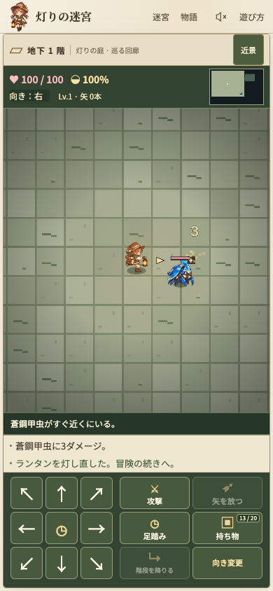

# 戦略拡充案 — 灯りを分け、戦場をつくる

## 文書の位置づけ

2026-10-17時点の設計提案です。以下は試遊の意見を反映した設計と、その検証計画です。末尾の「試作の実装状況」に現在の実装範囲を記録します。通常の冒険への採用は未決定で、数値は本番のバランスを保証するものではありません。

- 試遊反映の実装基準：`origin/main` `fb1e4aa192b2f66a5e0228f1e7a02f4c94a3029b`。
- 調査基準：`origin/main` `032ddb3ef9aba3af81a4fdb7d5623c2f1baafb0e`。
- 設計調査時のチェックアウト：`aa47324a40c81f2015d5884af12bbf8db4f65bb0`。基準より3コミット前でした。試作の実装は調査基準へ更新してから行っています。
- `data.js`、`engine.js`、`world.js`、`enemies.js`、`save.js`、`inventory-ui.js` は調査基準と一致することを確認しました。差分は主に主人公の描画です。
- 通常の10階・30階の冒険と試作は、入口・抽選・保存を分けます。

## 目指す体験

リネが祖母のランタンの火を分けると、攻撃する位置と戻る場所を選べます。拾った装備や札を、その場の地形と組み合わせて使うゲームを目指します。

1. 同じ包囲でも、迎撃、敵の攻撃の利用、位置交換による離脱という複数の解法がある。
2. 装備を拾うと、欲しい道具や選ぶ経路が変わる。
3. 成功した理由を盤面から理解でき、次の冒険で別の工夫を試したくなる。

独自性の仮説は、灯りを分ける行為が「迎え撃つ場所」と「退路を残す場所」の判断につながる点です。固定の装備セットだけに隠しボーナスを与える方式ではなく、共通の作用から組み合わせを作ります。

最初から燃料管理、装備部位、属性相性表を増やすことはしません。まず、既存の1行動1ターン、8方向、攻撃予告、持ち物20枠の中で検証します。

## 現行実装から確認した制約

- 武器6種、盾6種、灯札4種です。種族特効、装甲無視、空腹軽減、遠距離軽減はすでにあります。
- 武器・盾は各階それぞれ40%で出現します。種類の抽選率は階によらず共通です。
- 成長報酬は討伐中心です。矢は12、雷光は18の固定ダメージです。
- 所持金には、現在のゲーム内で消費先がありません。
- 部屋では広い範囲を視認します。敵は見えていて距離7以内なら覚醒し、その後はリネへ向かう経路を使います。別の対象へ注意を向ける状態はありません。
- 射撃・強打は対象マスを予告しますが、現在の着弾処理はリネへの命中判定が中心です。敵同士への命中は別途実装が必要です。
- 床のトゲ罠は現在リネだけを対象にします。敵を押しても、既存の処理のままでは罠は発動しません。
- 灯札の仮名は現在4種類です。札の追加には仮名、対象選択、識別、旧セーブの移行も必要です。

根拠：[定義](../dist/data.js)、[行動・戦闘](../dist/engine.js)、[生成](../dist/world.js)、[敵AI](../dist/enemies.js)、[保存](../dist/save.js)。

### 生成だけの事前調査

両迷宮についてシード1〜200でエンジンを初期化し、1階から5階まで順番に `generateFloor()` で生成しました。プレイヤー行動は行っていません。途中で戦闘などが乱数を消費する通常プレイとは、その後の階の生成結果が異なります。

- 入口から階段への最短歩数の中央値は、はじめの冒険の1〜5階で26、27、23、26、30歩、深淵で26、28、26、26、27歩でした。敵・罠・回収を無視し、既存の8方向移動と角抜け制約を使った値です。

これは配置の観測です。遭遇率、装備の回収率、到達率、クリア率、面白さの証拠には使いません。

設計への反映として、ランダムな装備出現とは別に、攻略の核を選ぶ機会を用意します。誘引の撤回に伴い、蛾を毎階配置する変更も取り下げました。

## 試遊後の試作に残す7種

鐘打ちの槌と返しの盾は、効果の前に足踏みを求める操作がテンポを損なうため取り下げました。追加装備も、通常の移動や攻撃の中で違いを生む設計を優先します。灯り・餌への誘引も、楽しくないという試遊の意見を受けて撤回しました。置き灯は仮宿の帰還先、団子は食料として残します。

以下の数値はすべて初期案です。武器・盾の補正値、呪い、持ち替えの1ターンは既存の仕組みを引き継ぎます。新しい品は、単独でも使え、組み合わせで用途が増えるものを優先します。

### 1. 灯守りの槍

- 武器の基本性能は攻撃力+2。通常の近接ダメージ式を使います。
- 敵の方向へ進む操作で、直線2マス以内の最初の敵1体をその場で突きます。攻撃ボタンを押す必要はありません。敵がいなければ通常どおり移動します。「攻撃」でも同じ射程で突けます。
- 方向入力による一突きは移動せず1ターンだけ進み、通常の攻撃と同じダメージ・乱数・敵行動を使います。向き変更だけでは攻撃しません。蔓で移動を封じられていても、届く敵への攻撃は可能です。
- 壁、閉じた角、手前の敵を越えて攻撃できません。射程外の敵への自動接近や、時間経過による自動攻撃は行いません。
- 得意な状況は、接近前の迎撃と、蔓によって保った間合いです。
- 接近後に距離を戻す機能はなく、速い敵、射撃、曲がった通路への対策が必要です。

### 2. 引き寄せの灯札

- 8方向の直線4マス以内にある、見えている敵1体または床アイテム1個を選び、手前へ最大2マス移動させます。
- 壁、閉じた角、他の対象を通り抜けません。リネのマスの一つ手前で止まります。
- 床アイテムは別の床アイテムの上へ重ねません。床に移動するだけで、自動回収はしません。
- 蔓やトゲ罠への誘導、槍の射程への引き込み、危険な場所の物資回収に使います。

### 3. 入れ替えの灯札

- 見えていて、壁で視線が遮られていない、距離4以内の敵1体と位置を交換します。距離は8方向の歩数に相当するチェビシェフ距離です。
- 交換は同時に行い、途中のマスは踏みません。着地先の仕掛けは各対象につき一度だけ発動します。
- 交換後も、敵がすでに予告したマスは変わりません。射撃の向きが成立しなくなった場合は空振りです。
- 番人も対象に含めます。交換するだけでは、構えを解除したり敵行動を飛ばしたりしません。

### 4. 仮宿の灯札

- 同じ階の置き灯へ移動し、置き灯を消費します。距離制限はありません。設置時に発見した位置なので、今は画面外でも使用できます。
- 着地先に敵がいる、置き灯が消えた、別の階に移った場合は使用できません。
- 成功時は着地先の仕掛けを発動し、通常どおり敵も行動します。帰還自体に無敵効果はありません。
- 帰還までの移動距離と、灯りが消えるまでの残り行動を考えて退路を準備します。

### 5. 灯種

- 見えている空き床へ、8方向の直線3マス以内で投げて置き灯を作ります。壁、閉じた角、途中の敵を越えて設置できません。
- 置き灯は一つだけです。すでにある場合は再設置を拒否します。回収、無料の移設、階を越えた持ち越しはできません。
- 灯りは距離2以内かつ壁に遮られないマスへ届きます。探索の視界や未知の罠・敵は明らかにしません。
- 設置直後から有効で、6回の敵行動フェーズが終わると消えます。設置したターンの敵行動も1回目に数えます。
- 魔物の注意や経路は変えません。仮宿の帰還先として使います。

### 6. 蔓の種

- 足元へ仕掛け、次に踏んだリネまたは魔物の自発移動を止めます。一度発動すると消えます。設置直後にリネ自身へは発動しません。
- 踏んだ行動の残りの移動と、その対象の次の行動の自発移動を止めます。攻撃、待機、道具使用、強制移動は可能です。足止めは行動不能ではありません。
- 強制移動で踏んだ場合も発動します。自分が仕掛けた蔓は見えたままで、階段には設置できません。
- 同じ対象の拘束は重ねず、拘束が解けた直後の1行動は新たな蔓を踏んでも再拘束しません。
- 味方が仕掛けた蔓による被害や拘束も、回避できるよう表示します。

### 7. 香り団子

- 食べると満腹度を15回復します。
- 食料としてのみ使い、投げる操作や魔物を集める効果はありません。持ち物満杯でも足元から食べられます。

消耗品は初期試作では一個一枠とし、新しい束ね処理は加えません。既存の矢の束は維持します。持ち物整理が判断を圧迫する場合に、灯種などの束ね方を別途比較します。

## 共通ルール

### 強制移動、罠、攻撃予告

- 引き寄せは移動先を順番に調べます。壁、角、盤外、他の対象を飛び越えません。強制移動だけで追加の敵行動は発生しません。
- 植物の「自発移動しない」性質と、強制移動への耐性は分けます。試作では植物も引き寄せ・交換が可能です。
- 新しい蔓と既存のトゲ罠は、魔物が通常移動・強制移動・交換で入った場合も発動するよう変更します。トゲ罠の既存ダメージ2〜5は維持します。魔物への発動だけを理由に未知の罠を地図へ表示しません。
- 罠や敵同士の攻撃で魔物を倒した場合も、討伐経験値・金貨は一度だけ付与します。移動や連鎖の途中で倒れた対象は以後の行動を行いません。
- 射撃は予告したマスへ向かい、途中の最初の対象に命中します。強打は予告マスにいる対象へ当たります。敵同士の命中も許容します。
- 射撃元を動かした結果、予告マスが射程外または8方向の直線外になった場合は空振りです。移動後の射撃元から壁や対象による遮断を再判定します。
- 対象の入れ替えや移動を理由に、予告マスをリネへ付け替えません。見えている予告とその変更は描画にも反映します。

### ターンと持続時間

1. 状態、対象、射程、着地先、所持品を検証します。取消と無効な確定では、時間、道具、識別、乱数を変えません。
2. リネの一つの行動を実行します。ダメージ、強制移動、着地の仕掛け、死亡を処理します。
3. 既存と同じ位置でターン加算、空腹、自然回復、ハウス入室を処理します。空腹で倒れた場合は敵を行動させません。
4. 生きている敵が、それぞれ最大一回の行動を行います。速い敵の一回の行動に複数歩を含む既存の性質は維持します。行動順は個体ID順で固定します。
5. 置き灯の残りフェーズ数を一度だけ減らし、期限を迎えた灯りを消します。視認状態と描画を更新し、自動保存します。

敵がこのフェーズで新たに予告した攻撃は、次の敵行動まで実行しません。強制移動は別のターンを再帰的に起こしません。蔓は対象の行動に結びつけて解除し、置き灯の寿命と同じ数え方にはしません。

### 保存と取消

- 置き灯・蔓の位置と残り時間、移動封じと再拘束への抵抗を保存します。
- 所持品と床アイテムは既存と同じ識別・呪い・個体の補正値を維持します。
- 階移動では置き灯、蔓、拘束を消します。次の階の対象へ参照が残らないようにします。
- 旧セーブに新しい状態がない場合は、空の盤面状態・未使用の個体状態として移行します。新しい版の読み戻しまで含めて保存形式を設計し、読めないデータを旧版で上書きしません。
- 既存の旧セーブが識別済みとして移行される意味と、新たに追加した未知の種類が識別済みになる意味を混同しません。

## 入手機会と冒険への導入

### 最初は専用の試作冒険で比較する

7種をいきなり通常の10階・30階へ混ぜません。固定状況と短い1〜5階の冒険で、効果単体と組み合わせを比較します。試作用の保存先と入口を分け、製品の進行解放・冒険セーブを上書きしません。

- 最初の支度台で槍を選べます。今の装備で進む選択も残します。試作で渡す品は識別済み・呪いなしとします。
- 灯種2個、蔓の種1個、香り団子1個を、見つけやすい場所に置きます。床からの直接使用も維持します。
- 新しい札は遭遇に合わせて配置し、一度に全種類の説明を出しません。
- 単独の射撃敵がいる回廊、複数の出口がある広間を用意します。装備は生成だけでなく、実際に発見できる配置を確認します。
- 道具を使わずに抜ける解法も残します。新道具の使用を進行条件にしません。
- 初期比較では敵のHP・攻撃力、レベル成長、空腹、既存の食料・回復配置を固定します。

### 通常の冒険への導入候補

- 攻略の核を選ぶ機会は序盤に一度設けます。道中はランダムな装備と補給で方向を伸ばし、固定の完成セットを保証しません。
- 食料・回復・鑑定・解呪の供給と、新しい戦術用アイテムの供給を別枠で抽選します。品数を増やした結果、既存の救済札が出なくなることを避けます。
- 商人は購入・補給・鑑定・解呪を所持金の使い道にします。価格と登場間隔は未決定です。通常プレイで金貨の取得、被害、使用枠数を測ってから設定します。
- 非討伐の攻略を正式に成立させる段階で、階層目標や初回の遺跡起動へ成長報酬を加えます。同じ場所での反復報酬は与えません。試作だけで「隠密ビルドが成立した」とは判定しません。

## 操作、識別、モバイル表示

- 「使用方法→対象の確認→確定」とし、確認中は敵を進めません。対象と着地先を見える盤面で示します。
- 対象選択で無効な場所を選んだときは、道具を失わず選び直せます。持ち物満杯でも足元の品を直接使えます。
- 自分が仕掛けた蔓、置き灯の残り時間、予告攻撃を区別します。色だけに頼らず形も変え、390×844と320×568で重なりを確認します。
- 武器に槍を加えるので、共通カテゴリの「剣」は「武器」へ変更します。既存の個別の剣名は維持します。
- 未識別札の対象UIは公開前の検討課題です。正体ごとに対象選択の種類を変えると、それ自体で正体が漏れます。対象に失敗したときだけ無料で種類を絞れる仕様も避けます。
- 初期試作では新札を識別済みに限定します。深淵へ投入する前に、種類を明かさない共通の対象選択と、既存の真名の札の取消契約が両立する操作を別途試作します。対象UIで効果が判明した後に、消費前へ戻せる操作は採用しません。

## 固定状況で確認する遊び

### 迎撃と離脱

部屋の入口で足元へ蔓を仕掛けて一歩下がります。追跡する敵が蔓へ入る配置と、別の経路で接近する配置を比較します。槍で迎撃する解法、入れ替えで離脱する解法、道具を温存して通常戦闘する解法を確認します。

同じ行動順を使えば必ず勝つ部屋を量産する目的ではありません。蔓・敵・出口の位置を変えることで、選ぶ行動が変わるかを評価します。

### 攻撃予告の利用

射撃敵と近接敵がいる広間で、回避、入れ替え、槍による迎撃、通常攻撃を比較します。複数の射線や横からの接近でも、攻撃だけでなく位置を選ぶ意味が残るかを確認します。

入れ替えで予告先に敵を置ける場合と、交換後に射線が成立せず空振りする場合を分けます。プレイヤーの予想と結果が一致するかを確認します。

### 退路への投資

広間の手前に置き灯を残してから物資を取りに行き、仮宿で戻る解法を試します。灯りが切れる直前、敵が灯りの上を占有した場合、帰還先に自分の蔓がある場合も扱います。

帰還地点を出口寄りに置く場合と、安全な入口に残す場合を比較します。帰還を必要としない安全な経路も比較対象にします。

## 検証と採否

### 機械的な受け入れ条件

- 射程、角抜け、遮断、占有、設置上限、死亡後の処理を確認します。
- 蔓の連続使用による無制限の拘束・循環がないことを確認します。
- 取消・無効操作で、セーブ内容、識別、道具、乱数が変わらないことを確認します。
- 設置直後、残り1フェーズ、消灯直後、拘束途中、階移動後の保存・再読込で、同じ操作の結果が一致することを確認します。
- 敵が入るトゲ罠、強制移動先の蔓、交換後の双方の罠、敵同士の攻撃・罠による死亡と報酬を確認します。
- 未発見の敵・罠・未識別の効果を、対象候補、軌道表示、ログ、APIの自動方策向け観測へ漏らさないことを確認します。
- 持ち物満杯での床使用、交換、取消と、既存の呪い・補正値・矢の束を維持します。
- 実装時は `node check.cjs` に加え、[ブラウザ自動プレイ](browser-playtest.md)の通常操作、モバイル表示、自動保存を検証します。事前調査時点では未実施だった新機能の検証結果は、末尾に記録します。

### 面白さの比較

まず固定状況で異なる解法が通ることを確認し、その後に同じ開始条件の短い冒険を比較します。アイテム追加により乱数列が変わるため、同じシード番号だけで同じ遭遇条件になったとは扱いません。固定状況では盤面・敵・所持品を揃え、通常生成の比較は別に集計します。

- 入手した道具をどの状況で使ったか、温存・放棄した理由を記録します。
- 体力損失、ターン、食料、消耗品、獲得物、進行を並べて評価します。速さだけ、被害だけで最良戦略を決めません。
- 「槍を拾った結果、蔓を持ち帰った」など、取得した品が次の判断を変えた事例を残します。
- 置き灯の配置、相互作用の発動、退路の成否を、行動前後の状態と画像で残します。
- 自動方策は製品UIを操作し、発見済みの情報だけを使います。道具を使えない旧方策との比較を、そのまま新機能の価値判定には使いません。
- 初見プレイヤーにも説明なしの試遊と短い聞き取りを行い、何を狙い、何が起きたと理解したかを確認します。少人数の結果は観察として記録し、一般的な成功率にしません。

採用には、複数の状況で異なる解法が成立し、一つの手順がどの盤面でも優位にならず、初見の人が結果の理由を理解できることを求めます。勝率や平均ダメージだけでは採用しません。

## 実装の分け方

1. **間合いと攻撃予告**：共通の強制移動・敵同士の命中・罠の着地処理を整え、槍の方向入力と射程を固定状況で検証します。各段階で、既存の戦闘と保存の回帰を確認します。
2. **灯りと退路**：置き灯、蔓、団子、3種の札と保存・対象UIを加え、7種がそろった短い試作冒険を検証します。
3. **通常冒険への導入**：初見試遊と通常生成の観察を受けて、入手枠、呪いの救済、未識別札の操作、商人、非討伐の成長を順番に検討します。同時に変更して効果の原因が分からなくなることを避けます。

主な変更候補は、定義が `dist/data.js`、行動と着地処理が `dist/engine.js`、追跡と予告が `dist/enemies.js`、配置が `dist/world.js`、保存が `dist/save.js`、操作と表示が `dist/inventory-ui.js`・`dist/game.js`・`dist/renderer.js` です。必要になった共通処理だけを抽出し、先に汎用の戦闘フレームワークを作ることはしません。

次の追加候補は影縫いの短剣、残響の剣、棘蔓の盾、共鳴札、障壁札、静寂札、蛍蜜、露の小瓶です。水と雷の伝導、植物・遺跡の反応、ランタンの基本アクション化は、7種で生まれる判断を確認してから進めます。

未決定なのは、本番の出現率と価格、深層の威力調整、未識別札の操作、非討伐の成長配分です。初期値と検証結果を分けて記録し、試作しただけでこれらを確定扱いにしません。

## 参考にした一次資料

- [任天堂：ティアーズ オブ ザ キングダムの能力](https://www.nintendo.com/en-ca/whatsnew/get-to-know-links-four-new-abilities-in-the-legend-of-zelda-tears-of-the-kingdom/) — 物と能力を組み合わせ、用途を広げる設計の参考です。
- [Playstack：Balatro](https://www.playstack.com/games/balatro/) — 獲得物によって組み合わせと攻略方針が変わる設計の参考です。
- [Subset Games：Into the Breach](https://subsetgames.com/itb.html) — 予告を読み、対処を組み立てる戦闘の参考です。
- [Supergiant Games：Hadesの更新紹介](https://www.supergiantgames.com/blog/5/) — 武器の変化と功徳を組み合わせる設計の参考です。
- [Larian：Divinity: Original Sinの環境相互作用](https://larian.com/support/faqs/what-is-environment-interaction_35) — 水・油・火・雷などが戦場へ作用する設計の参考です。

これらは参考作の仕組みを示す資料です。本作での面白さ、独自性、適切な数値を証明するものではなく、本書の具体案は本作向けの設計判断です。

## 試作の実装状況（2026-10-17）

`?trial=strategy` から、地下5階までの試作を起動できます。最初の7種と支度選択、照準・取消、置き灯の寿命、強制移動、魔物への罠、敵同士の予告攻撃、専用の保存・再開を実装しました。試作ロジックは `dist/strategy.js` にまとめ、通常の冒険では有効にしません。

保存キーは `lantern-strategy-trial-v2`、魔物記録は `lantern-strategy-monsters-v2` です。保存形式は試作専用のversion 2で、本編のversion 1とは相互に読み込みません。旧試作の槌は同じ基本攻撃力の灯守りの槍、返しの盾は同じ基本防御力の旅人の盾へ変換します。装備中・袋・床のすべてで補正値・呪い・鑑定・位置を維持し、旧溜め状態は削除します。旧版の設置済みの餌・誘引先・使用済み状態も、形式を検証してから削除し、置き灯・蔓・拘束・攻撃予告・所持品は維持します。読めない試作セーブは自動で上書きせず、保存無効を表示します。

初期版では補給品を最初から持ち、2〜5階へ追加補給を配置します。既存の部屋生成を使い、2階以降に射撃敵を配置します。蛾の追加配置は行いません。専用の手作りの庭・回廊はまだ作っていません。固定状況の比較は検証用セーブで行います。

モバイルでは照準中の攻撃欄を確定・取消へ切り替え、方向ボタンで照準を動かします。迷宮・体力・満腹度・ミニマップ・記録・操作を同じ画面に残します。新しい品の絵は試作用の記号表示です。

`node check.cjs` は通常冒険の回帰検証と、方向入力・攻撃ボタンの8方向一致、射程・遮断・拘束、旧装備と誘引状態の保存移行、灯りによらない追跡、団子の食事専用化、7種、取消時の状態不変、寿命、拘束・抵抗、保存の一致、20シード×5階の試作生成を検証します。`tests/check-strategy-browser.cjs` は390×844・320×568の実ブラウザで、製品DOMの操作とキャンバスのポインター入力を検証します。槍は方向ボタンとキーボードで攻撃し、向き変更では攻撃しないことも確認します。出力先には条件別画像、設置時・再読込後の状態、実行ソースのハッシュ、検証結果を保存します。

今回の検証では上記のチェックが通過し、ブラウザの例外は0件でした。オフラインでの試作再読込も確認しました。ローカルでは `node scripts/serve.cjs 4173` を使います。通常の簡易HTTPサーバーでは `/combat-preview` が404になり、PWAの資産保存が失敗するためです。

商人、非討伐の成長、深層の威力調整、未識別の新札、植物・遺跡の変化、水と雷の伝導は未実装です。人間の初見試遊、通常プレイでの攻略比較、残った仕組みの面白さの評価も今後の検証です。

### 方向入力による槍の操作

下図は390×844の固定検証状況です。2マス先の敵へ方向ボタンで攻撃し、リネは元の位置に留まります。画像は敵行動後で、敵は隣接位置へ進んでいます。体力100・固定配置は操作検証用であり、通常プレイの攻略結果ではありません。

